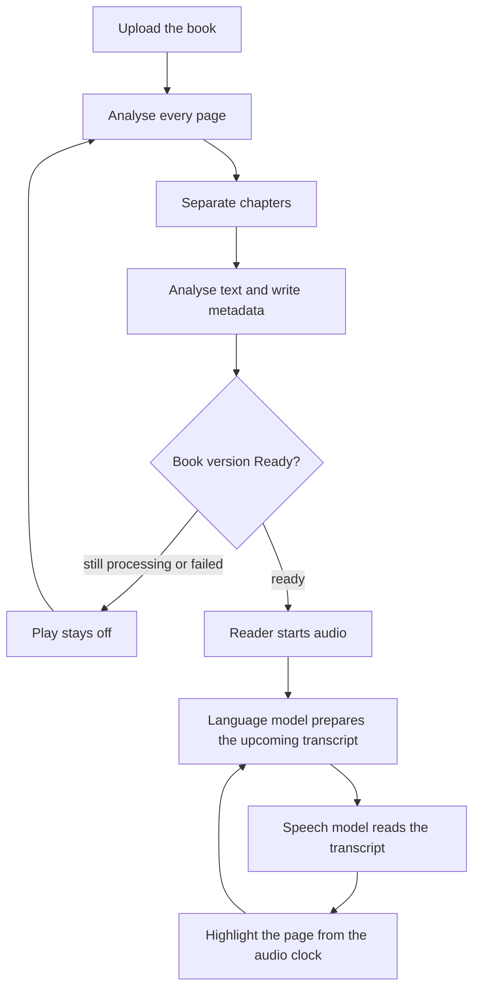
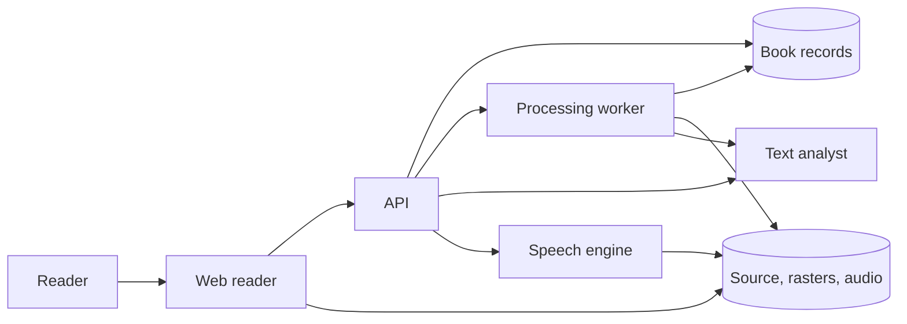
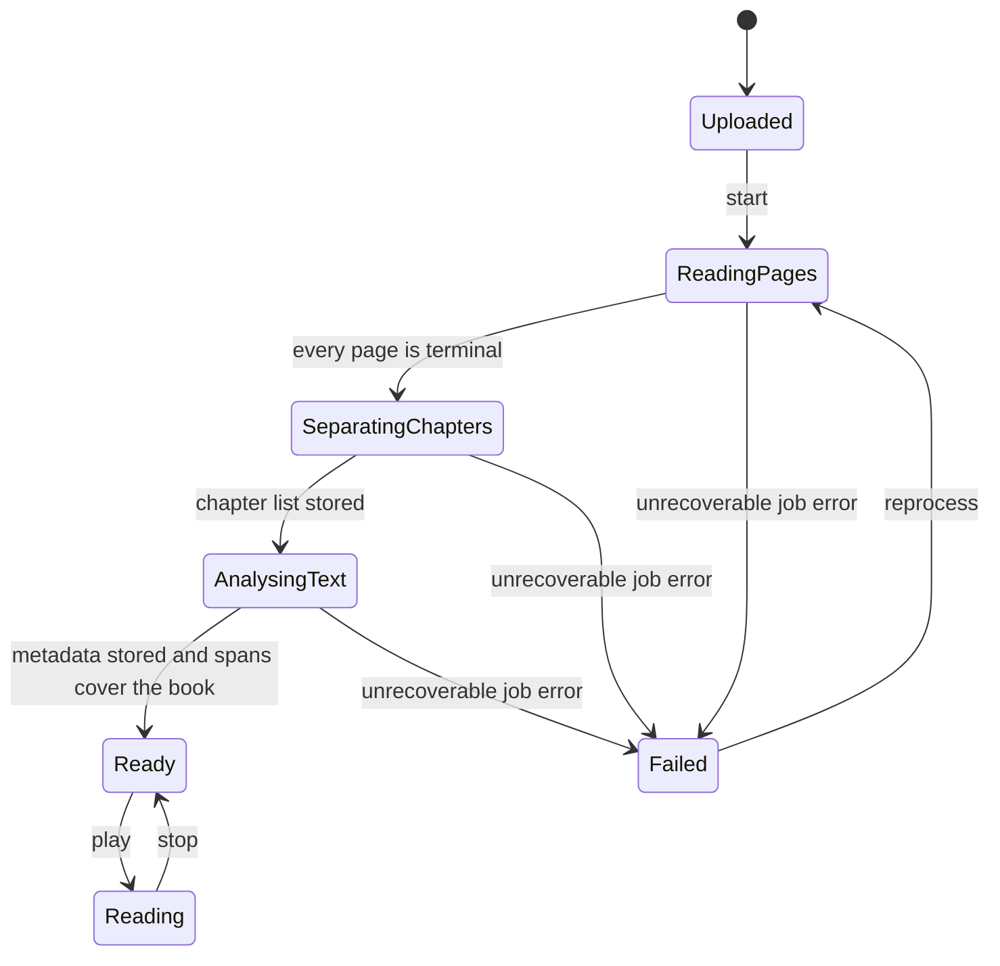
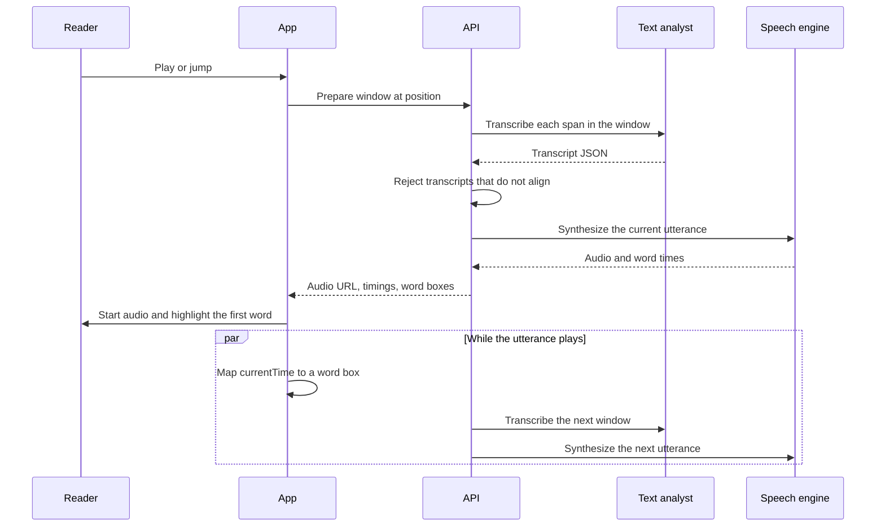
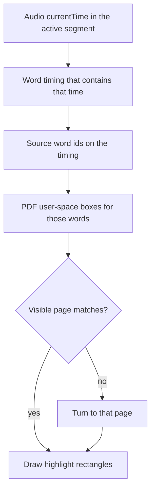
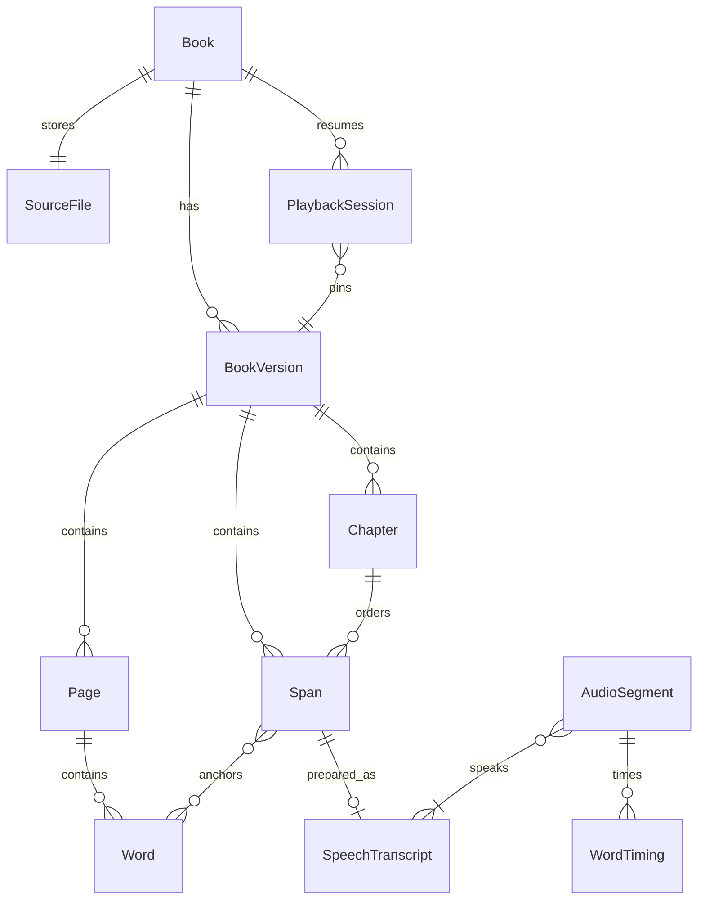

# Open Book Reader — design discussion

Status: discussion. This file records the product behavior, the processing and playback design, and a **suggested** stack. Nothing here is an implementation commitment. The stack in [Suggested stack](#11-suggested-stack) is a proposal to react to. Model vendors stay replaceable behind the interfaces in that section.

Discussion thread: https://github.com/manishsharma004/open-book-reader/issues/1

The original request, and where this document answers it:

| Request | Where it is specified |
| --- | --- |
| User uploads a book | [Upload](#51-upload) |
| Analyse the pages | [Page analysis](#52-page-analysis) |
| Separate the chapters | [Chapter separation](#53-chapter-separation) |
| Analyse the text and create full metadata | [Text analysis and metadata](#54-text-analysis-and-metadata) |
| Audio reading starts only after processing is done | [When play becomes available](#55-when-play-becomes-available) |
| A language model analyses the book in realtime | [Realtime preparation](#62-realtime-preparation) |
| Build transcription text for speech, with punctuation and emotion | [Speech transcript](#63-speech-transcript) |
| A speech model reads that transcription | [Speech synthesis](#64-speech-synthesis) |
| Page text highlights in sync with the audio clock | [Highlight sync](#65-highlight-sync) |

## 1. Product

A reader uploads a book they already have. The system studies the pages, finds the chapters, reads the text, and stores a structured description of the book. When that work has finished, the reader may press play.

During playback a language model prepares the upcoming passage for speech: the words to say, the punctuation that shapes pauses, and an emotion for delivery. A text-to-speech model speaks that transcript. The page highlights the words that are sounding at the audio element's current time.

The page the reader sees is the book page, not a reflowed article. Highlighting has to land on the printed text.

### In scope for this design

- One reader and the books they upload.
- A batch processing pipeline that must finish before play.
- A realtime path that prepares speech while a ready book is playing.
- A sync contract between audio time, spoken words, and page position.
- Enough metadata to describe the book, its chapters, and how names are pronounced.

### Out of scope for this design

- Choosing a final model vendor, hosting region, or price.
- Accounts, sharing, billing, and storefronts.
- Editing the book's prose.
- A mobile app. The reader is a web app in the suggestion below.
- Legal advice about the uploaded file. The product stores a file the reader supplies and treats it as private to them.

## 2. Reader journey

1. The reader uploads a book file and sees it appear as **Uploaded**.
2. Progress moves through page analysis, chapter separation, and text analysis. Play stays disabled.
3. Warnings are visible while the reader waits: low-confidence pages, missing title, uncertain chapter breaks. Processing can still finish with warnings.
4. The book becomes **Ready**. The reader sees the chapter list, the metadata, and Play.
5. Play starts at the first speakable passage, or at the last position if they have listened before.
6. Audio starts. The current word (or, if word times are missing, the current passage) is highlighted on the page. When the spoken word sits on the next page, the page turns and the highlight follows.
7. Pause, seek, speed changes, chapter jumps, and clicks on a word all move the same audio clock. The highlight reads that clock. It does not run on a second timer.
8. Leaving and coming back restores the position.



The cycle through prepare, speech, and highlight is the listening session. The path from upload to the gate is the batch pipeline. Play is not offered from a half-finished pipeline.

## 3. Two different uses of the language model

These are easy to collapse, and they should stay separate.

**Batch, before play.** The model helps separate chapters, fill metadata, write summaries, list people, and attach pronunciation hints. Input is the extracted text of the book (by chapter, not one unbounded paste when the book is long). Output is stored on the book version. This work is part of "processing is done."

**Realtime, after play.** The model looks at the passage about to be spoken, plus a small amount of context, and writes the speech transcript: punctuation, pauses, emotion, dialogue versus narration. Output is cached per passage and voice settings. This work is not part of the gate. A book can be Ready and still generate the next transcript a few seconds ahead of the voice.

Batch understanding makes the realtime call cheaper and more stable. The realtime call should not re-discover the chapter list or the cast on every sentence.

## 4. System shape



Batch jobs run on the worker. The listening session calls the text analyst and the speech engine through the API, which caches transcripts and audio on the book version. The browser never talks to a model directly.

## 5. Batch processing

A **book version** is one complete analysis of one upload. Re-running analysis creates a new version. Playback binds to a version, so a reprocess does not move highlights under an active session. The new version becomes the one Play uses only after it is Ready.



A page that cannot be read is **terminal**. It is stored as unreadable, with no invented text. It does not by itself fail the book. A job crash, a corrupt file, or an analyst failure that leaves chapters or metadata unfinished does fail the version. The previous Ready version, if any, stays the one the reader can play.

Page jobs may run in parallel. Chapter separation starts after every page is terminal. Per-chapter summaries may run in parallel after the chapter list exists. The version becomes Ready only when the whole book has passed the gate in [When play becomes available](#55-when-play-becomes-available).

### 5.1 Upload

The reader sends a file. The API stores the bytes, records the filename, size, and media type, and creates a book version in **Uploaded**.

Suggested first format: **PDF**, both text-layer PDFs and scanned PDFs. Page highlighting needs a stable page and a coordinate system. EPUB reflows with window width, so "the page" is not stable until we paginate for a specific layout. Photos of pages are a third extractor. Both can be added behind the same page extractor. They are not required to discuss the rest of this design.

The original bytes stay stored so a later version can be built without asking for the file again.

### 5.2 Page analysis

Each page produces:

- `page_index`, zero-based, in the file's order.
- `width` and `height` in PDF points.
- An ordered list of **words**. Each word has the printed text, a bounding box, a reading-order index, and a role.
- A page confidence and the extractor that produced it: `text_layer` or `ocr`.
- Warnings: low confidence, possible multi-column uncertainty, image-only page, encoding garbage.

Bounding boxes are in **PDF user space**: origin at the bottom-left of the page, units in points, unscaled. The client converts them with the same viewport it uses to draw the page. Pixel boxes from a thumbnail are not the stored geometry. Scanned pages still use this space: render at a known scale, OCR in that pixel space, and convert boxes back to PDF points.

Word roles:

| Role | Spoken by default |
| --- | --- |
| `prose` | yes |
| `heading` | yes |
| `footnote` | no, until the reader turns footnotes on |
| `caption` | no, until the reader turns captions on |
| `header` | no |
| `footer` | no |
| `page_number` | no |
| `table` | no; the words stay visible on the page |
| `unreadable` | no |

Dialogue is not a page-analysis role. It is a classification of prose spans, assigned later when the speech transcript is written.

Reading order is part of the page record. A two-column page stores column one top-to-bottom, then column two. Headers and footers are identified so they are not inserted into the column flow. Line-end hyphenation is joined into one speakable word and keeps both boxes, so the highlight can cover the split glyph and the speech says the whole word once.

OCR text is accepted only with its confidence. Below a threshold (a number to pick during implementation, suggested starting point 60 on a 0–100 word confidence), the word is `unreadable` and is not spoken. A vision-model pass may retry that page once. If it still fails, the page stays unreadable and the reader sees a marker where that page would have been read.

The extractor does not paraphrase. It records glyphs it can defend.

### 5.3 Chapter separation

A chapter is a title plus a half-open range of speakable spans: start inclusive, end exclusive. Ranges do not overlap and, together with any explicitly skipped front matter, cover every speakable span.

Signals, used together:

1. A table of contents, when the book has one. TOC entries carry a target page. They are the strongest signal.
2. Heading words from page analysis (`Chapter`, `Part`, numbered headings, a heading role plus a following prose block).
3. A language-model proposal when the first two disagree or are missing. The model receives heading candidates and the TOC text, not an instruction to invent chapters that have no anchor. Every proposed boundary must cite a page and a word id. A boundary with no anchor is discarded.

Each chapter stores `title`, `start_word_id`, `end_word_id`, `confidence`, and `source` (`toc`, `heading`, or `model`). The reader can correct a boundary later. A correction writes a new book version whose spans are retargeted. It does not require a new upload. Correcting chapters is part of the design even if the first build only displays the suggestion.

Front matter (title page, copyright, dedication, contents) and back matter (index, bibliography) are chapters or non-chapters with a `matter` flag. The default listening path skips the contents pages and the index. The reader can open them.

### 5.4 Text analysis and metadata

"Full metadata" means the catalog below. A field that is not in the book is stored as unknown. The model must not fill a plausible author, year, or ISBN from outside knowledge. Inferred fields (a synopsis, a character description) are marked `inferred` and carry the span ids they are based on.

**Bibliographic**

- title, subtitle
- authors, in order
- language and script
- publisher, place, year
- ISBN
- edition

**Structure**

- page count
- chapter tree (a part contains chapters; a chapter contains sections when headings support that)
- word count, and speakable word count
- estimated listening time at the default words-per-minute, recomputed when the reader changes speed

**Understanding**

- short synopsis and a longer synopsis
- per-chapter summary
- people: display name, aliases, a one-sentence description, pronunciation
- places and other proper nouns that need a pronunciation
- optional content note, only when specific spans support it, stored with those span ids

**Quality**

- pages by extractor (`text_layer` vs `ocr`)
- unreadable pages
- low-confidence chapter boundaries
- fields left unknown

Every stored value has provenance: `found` (with word ids) or `inferred` (with word ids), plus a confidence from 0 to 1.

Pronunciation hints exist so the speech adapter can say a name the same way throughout the book. They are metadata, produced in batch, and consumed by the realtime transcript.

### 5.5 When play becomes available

A version is **Ready** when all of the following are true:

1. Every page has a terminal analysis record, including pages marked unreadable.
2. The chapter list is stored, every boundary has a word anchor, and the ranges cover the speakable words without overlap.
3. The speakable span list is stored and each span points at one or more words.
4. The metadata record is stored. Unknown fields are allowed. A crashed metadata job is not "unknown"; the version stays not Ready.
5. Bibliographic fields that were found in the text cite their anchors. The synopsis and per-chapter summaries are present or explicitly marked as skipped with a warning. A skipped summary does not block Ready. A missing metadata record does.

Realtime transcripts and audio files are not required for Ready. They are created when the reader plays, and then cached.

Until Ready, the client shows progress and does not start audio.

### 5.6 The speakable span

The span is the contract between metadata, speech, and highlighting.

A span is a short run of words in reading order, usually a sentence, that will be prepared and spoken as a unit. It stores:

- stable id
- book version id
- chapter id
- order index
- role: `narration`, `dialogue`, or `heading` (finer roles can wait)
- source word ids, in order
- source text: the words joined with normalized whitespace, hyphenation already resolved, punctuation kept as printed

Spans do not contain headers, footers, or page numbers. Footnotes and captions are spans with `spoken: false` until a setting turns them on.

Spans are immutable inside a book version. A corrected chapter list or a new extraction is a new version.

## 6. Listening session

### 6.1 Position

A playback position is `(book_version_id, audio_segment_id, offset_ms)` once audio exists. Before the first synthesis for a jump target, the position is `(book_version_id, span_id, word_id)`.

The session stores that position on pause and on a short interval while playing, so a closed tab can resume.

### 6.2 Realtime preparation

When play starts, or when the reader jumps, the API prepares a **lookahead window**: the current audio segment and the next two. While segment N is playing, the window slides so N+1 and N+2 are ready before N ends.

Preparation for a span:

1. Load the span's source text and word ids.
2. Load context: the previous span's transcript, the next span's source text, the chapter summary, the people and pronunciation sheet, and the reader settings (voice, emotional intensity `subtle` or `full`, whether footnotes are spoken).
3. Ask the text analyst for a speech transcript that obeys the schema in the next section.
4. Validate alignment. On failure, keep the source text as a single clause with emotion `neutral` and the original punctuation.
5. Synthesize audio for a group of validated transcripts (an **utterance**).
6. Store the transcript, the audio, and the word timings. The cache key is `(book_version_id, utterance_span_ids, voice_id, style_id, transcript_hash)`.

A jump cancels lookahead that is no longer near the new position. Cached audio for the destination is reused.

If the current utterance is not ready, the reader sees **Preparing** and hears nothing. The fallback transcript (original words, neutral emotion) is tried before surfacing a failure. The player does not skip ahead, because a skip would desynchronize the page from the story.



The realtime call sees a window, not the whole book. The batch pass already stored the book-level picture. Sending the entire book on every sentence is out of scope for this design.

### 6.3 Speech transcript

The transcript is what the speech engine receives. It is not a retelling. The page highlights printed words, so the spoken words have to be those printed words.

Internal schema:

```json
{
  "span_id": "sp_0142",
  "book_version_id": "bv_01",
  "clauses": [
    {
      "text": "Stop,",
      "emotion": "tense",
      "role": "dialogue",
      "speaker": "Mara",
      "pause_after_ms": 180,
      "source_word_ids": ["w_12_088"]
    },
    {
      "text": "she said.",
      "emotion": "somber",
      "role": "narration",
      "speaker": null,
      "pause_after_ms": 280,
      "source_word_ids": ["w_12_089", "w_12_090"]
    }
  ]
}
```

Rules:

- `text` carries the words and the punctuation. Punctuation is how the voice phrases the line: commas, periods, question marks, ellipses, em dashes.
- The analyst may restore punctuation that extraction dropped. It may not replace, delete, or add content words. "Dr." stays "Dr." in the first version; a pronunciation override for a known abbreviation is a later, explicit field, not a silent rewrite.
- `emotion` is a closed set: `neutral`, `calm`, `warm`, `tense`, `somber`, `excited`, `whispered`, `angry`. Anything else is stored as `neutral`.
- `role` is `narration`, `dialogue`, or `heading`.
- `speaker` is an optional name that must already exist on the people list. The analyst does not invent a cast.
- `pause_after_ms` is a hint. The speech adapter may honor it as a break. Suggested cap: 800 ms, so a hint cannot insert a long silence.
- `source_word_ids` map the clause back to page words, in order.

Alignment check before the transcript is kept:

1. Compare clause text to the source words after case-folding and after treating punctuation as separate from words.
2. Accept when the content words are the same sequence. Punctuation may differ.
3. Reject otherwise, and use the fallback clause (source text, `neutral`).

Emotion is not drawn on the page. The page shows the book. Emotion affects the voice only.

The speech adapter compiles clauses into whatever the current engine accepts. For an engine that understands SSML, emotion and pauses become SSML. For an engine that accepts plain text, the adapter sends the punctuated text and drops emotion tags it cannot express. The stored transcript still has the emotion, so a later engine can use it without another analyst call.

Example of the same sentence as SSML, produced by the adapter, not stored as the source of truth:

```xml
<speak>
  <prosody emotion="tense">Stop,</prosody>
  <break time="180ms"/>
  <prosody emotion="somber">she said.</prosody>
</speak>
```

Engines name emotions differently. The adapter owns that translation. The rest of the system only sees the closed set above.

### 6.4 Speech synthesis

Consecutive ready transcripts are grouped into one **utterance** so the voice can phrase across sentence boundaries. Grouping rules:

- Target about 8 to 25 seconds of speech. Short enough to seek and to retry, long enough for prosody.
- Do not cross a chapter boundary.
- May cross a page boundary. The page turns in the middle of the audio when the word's page changes.
- Do not include a span with `spoken: false`.

The speech engine returns:

- audio bytes (suggested container: audio the browser can play in an `<audio>` element, such as AAC in M4A or Opus in audio/webm; pick one at implementation time and store the media type)
- duration
- word timings: `{source_word_id, start_ms, end_ms}` relative to the start of this audio segment

Timings come from the engine when it provides them. When it does not, an aligner runs on this audio and the known transcript text, and the timings are mapped back through `source_word_ids`. If alignment also fails, the segment is stored with utterance-level timing only: the whole utterance's spans highlight for the duration, and the record is marked `coarse`. Coarse is a degraded mode, not the default.

### 6.5 Highlight sync

The audio element is the only clock. `currentTime` of the playing segment, interpreted with that segment's word timings, selects the word. Playback rate changes `currentTime` and the highlight together. Pause freezes both. A scrubber sets `currentTime`. There is no parallel animation timer estimated from word counts.



Client rules:

1. On each animation frame while playing, and on `seeked` and `ratechange`, read `currentTime`.
2. Find the timing with `start_ms <= currentTime < end_ms`. In a gap between words, keep the previous word highlighted.
3. Resolve source word ids to boxes.
4. If those words are on another page, change the page, then draw.
5. Convert PDF user-space boxes through the page viewport into overlay rectangles. The overlay sits on the rendered page. String-matching against a second text extractor is not the highlight method, because the two extractors will disagree on hyphenation, ligatures, and order.
6. A click or keyboard activation on a word seeks the audio to that word's `start_ms`, loading the segment first if needed. The highlight moves because the clock moved.

Chapter next and previous seek to the first spoken word of the target chapter. If that utterance is not cached, the UI shows Preparing on that chapter, builds it, then seeks.

Speed is a playback rate on the audio element (suggested range 0.8 to 1.6). It does not rewrite the transcript.

### 6.6 Worked example

Invented passage, as stored after page analysis. Page 3. Boxes are illustrative PDF points.

| Word id | Text | Box (x, y, w, h) |
| --- | --- | --- |
| w1 | Mara | 72, 640, 36, 12 |
| w2 | waited. | 112, 640, 52, 12 |
| w3 | The | 72, 622, 24, 12 |
| w4 | station | 100, 622, 48, 12 |
| w5 | clock | 152, 622, 36, 12 |
| w6 | had | 192, 622, 24, 12 |
| w7 | stopped | 72, 604, 52, 12 |
| w8 | at | 128, 604, 14, 12 |
| w9 | noon. | 146, 604, 36, 12 |

One span, `sp_3_1`, words w1–w9, role `narration`, chapter "Chapter 1".

Realtime transcript:

| Clause text | Emotion | Source words |
| --- | --- | --- |
| Mara waited. | calm | w1, w2 |
| The station clock had stopped at noon. | somber | w3–w9 |

The content words match, so the transcript is kept. "waited." and "noon." keep their periods.

The speech engine returns a 4.2 s segment. Mapped timings:

| Start | End | Word |
| --- | --- | --- |
| 0.00 | 0.48 | w1 Mara |
| 0.48 | 1.05 | w2 waited. |
| 1.40 | 1.62 | w3 The |
| 1.62 | 2.10 | w4 station |
| 2.10 | 2.48 | w5 clock |
| 2.48 | 2.70 | w6 had |
| 2.90 | 3.40 | w7 stopped |
| 3.40 | 3.58 | w8 at |
| 3.58 | 4.20 | w9 noon. |

At `currentTime = 1.80` the highlighted word is **station**, box `(100, 622, 48, 12)` on page 3, converted by the current viewport. The gap from 1.05 to 1.40 keeps **waited.** highlighted. A click on **noon.** seeks to 3.58. At rate 1.5 those same millisecond boundaries still apply, because they are inside the audio's own timeline.

If this segment had only coarse timing, the highlight would cover w1–w9 for the whole 4.2 s and the record would say `coarse`.

## 7. Records

Names for the design, not a physical schema.



- **Book.** Owner, title hint from the filename until metadata replaces it, current Ready version id.
- **SourceFile.** Object-storage key, media type, byte size, hash.
- **BookVersion.** State, warnings, created time. Immutable once Ready except for cached transcripts and audio, which attach to it without changing spans.
- **Page, Word.** As in page analysis.
- **Chapter, Span.** As above.
- **Metadata.** The catalog in [Text analysis and metadata](#54-text-analysis-and-metadata), one record per version, fields individually provenanced.
- **SpeechTranscript, AudioSegment, WordTiming.** Cache. Safe to delete; playback can rebuild them.
- **PlaybackSession.** Version id, segment id, offset, rate, voice, style.

Ids are opaque strings. Page numbers are attributes, not identities, because a reprocess can change them. Sessions point at a version so identities stay stable for the life of that version.

## 8. Failure behavior

| Situation | Behavior |
| --- | --- |
| Corrupt file, no pages | Version **Failed**. Message explains that the file could not be opened. |
| One OCR page fails | That page is unreadable. Other pages continue. The listening path shows a short marker and moves to the next spoken span. |
| Chapter model returns a boundary with no word id | Boundary is dropped. If nothing remains, the book is one chapter titled with the book title, and a warning is stored. |
| Metadata call fails | Version is not Ready. Retry the metadata job. Spans already built are kept inside the version. |
| Transcript fails alignment | Fallback clause: original span text, neutral emotion. Highlight still has word ids. |
| Speech engine or aligner errors | Preparing state, then a retry. The player does not skip the span. |
| Alignment cannot produce word times | Segment marked `coarse`. Highlight the utterance's spans for its duration. |
| Reader seeks into an uncached chapter | Preparing on that chapter, then play from its first spoken word. |
| Reprocess while a session is open | The open session keeps its version. The next new session uses the new Ready version. |

Progress for the waiting screen is countable: pages terminal / pages total, then chapters, then metadata. Percentages that jump backward are worse than stage counts.

## 9. Privacy

The book is private to the uploader. The design still sends text off the machine when the suggested hosted models are used:

- Batch analysis sends extracted chapter text and heading candidates to the text analyst.
- Realtime preparation sends the upcoming spans and a small context (previous transcript, chapter summary, pronunciation sheet) to the text analyst.
- Speech synthesis sends the transcript, which is the printed words plus emotion, to the speech engine.

The browser receives audio and geometry. It does not receive API keys, and it does not call the models.

A local analyst and a local speech engine can sit behind the same interfaces. That alternative is for the case where this data flow is unacceptable. Emotion quality has to be judged again on that path. See the stack section.

Caches (transcripts, audio) are derived data and can be deleted without deleting the book version.

## 10. Settings that change output

Stored on the playback session, and part of the audio cache key when they change the sound:

- voice
- emotional intensity: `subtle` (bias emotions toward `calm` / `neutral` unless the transcript says `whispered` or `angry`) or `full` (use the transcript emotion as returned)
- speaking rate, applied at playback, not by regenerating audio
- footnotes on or off
- captions on or off

Changing voice or intensity prepares a new window. Changing rate does not.

## 11. Suggested stack

Proposal for discussion. It is specific so we can argue about something concrete. It is not a lock, and implementation should not start from this section alone.

### 11.1 Shape

A web reader plus a Python API and worker.

```text
apps/web          Next.js, React, TypeScript
apps/api          FastAPI
apps/worker       same Python package, queue entrypoints
specs/discussion  this document
```

Local development runs those processes with PostgreSQL, Redis, and MinIO.

The split exists because page extraction, OCR, and audio alignment are Python libraries, and the highlight has to be a web page on top of the real PDF. One language would mean reimplementing either the document stack or the reader.

### 11.2 Components

| Concern | Suggestion | Why this one |
| --- | --- | --- |
| Reader UI | Next.js and React | Upload, progress, chapter list, and the player in one app |
| Draw the PDF | PDF.js | Renders the page the file actually contains |
| Highlight | Rectangles on an overlay, converted with the PDF.js viewport | Geometry comes from our stored PDF-point boxes. We do not match strings against PDF.js's text layer |
| API | Python 3.12, FastAPI, Pydantic | Shared types with the worker and the transcript schema |
| Jobs | Redis and ARQ | The upload request returns as soon as the file is stored. Page jobs run in parallel |
| Records | PostgreSQL | Versions, pages, words, spans, transcripts, sessions |
| File bytes | S3-compatible storage; MinIO locally | Source PDF, rendered rasters, audio segments |
| Text-layer PDF | PyMuPDF | Words and boxes in PDF user space |
| Scanned PDF | PyMuPDF render, then Tesseract | First OCR path. A vision-model retry only for low-confidence pages |
| EPUB, camera images | Later, same `PageExtractor` interface | Stable pages are the highlighting problem we are solving first |
| Text analyst | Hosted model with JSON-schema output, behind `TextAnalyst` | Chapters, metadata, and transcripts are structured output. Starter to discuss: OpenAI structured outputs. Same schema can target Anthropic or Gemini |
| Speech | Expressive TTS behind `SpeechEngine`. Starter to discuss: an ElevenLabs-class API | The product asks for emotion, punctuation, and a voice, not a flat reader |
| Word times | Engine timings when present; otherwise faster-whisper alignment against the known transcript | Highlight needs times even when the voice does not return them |
| Clock | HTML `<audio>` `currentTime` | One clock for play, pause, seek, and rate. A hand-rolled timer drifts |
| First-deploy access | Single owner, or a proxy in front of the app | Multi-user auth is out of scope. Books stay private to that owner |

### 11.3 Interfaces

These three seams are the point of the suggestion. The libraries above can change without changing spans, transcripts, or the highlight clock.

```text
PageExtractor.extract(source) -> pages and words

TextAnalyst.propose_chapters(headings, toc) -> anchored boundaries
TextAnalyst.write_metadata(chapters) -> provenance-bearing metadata
TextAnalyst.transcribe(span, context, style) -> speech transcript

SpeechEngine.synthesize(transcript, voice) -> audio and optional word times
Aligner.align(audio, transcript) -> word times
```

`TextAnalyst` has three methods because the batch and realtime prompts are different. They share one client and one schema validator.

### 11.4 Local-model alternative

If chapter text and transcripts must not leave the machine, the same interfaces point at a local instruction-following model and a local speech engine such as Piper or Kokoro, with faster-whisper still doing alignment. OCR via Tesseract is already local in the suggestion. The thing to re-evaluate on this path is emotion: many local voices will ignore the emotion field, and the punctuated text will carry the delivery alone.

### 11.5 What this suggestion intentionally leaves open

- The exact model version and the account that bills it.
- Audio codec, as long as the browser can play it and we store the media type.
- The numeric OCR confidence cutoff.
- Whether the first screenshot of the product includes a chapter-correction UI or only displays suggested chapters.
- How large a PDF the first version is expected to finish. The pipeline is per page, so size is a cost and time question, not a different architecture. A suggested discussion target is a 400-page novel.

## 12. Open questions

1. Is PDF-only the right first upload, with EPUB explicitly later?
2. Is the Ready gate correct to wait for the whole book, rather than allowing play from chapter 1 while later chapters are still processing? This document follows the request: processing finishes, then audio starts.
3. Should headings be spoken, and should "Chapter 3" be spoken as well as shown?
4. May the transcript restore punctuation the extractor dropped, given that content words must stay identical?
5. Is word-level highlight the acceptance bar, with coarse utterance highlight only as a failure mode?
6. One voice for narration and dialogue in the first version, or a second voice when `speaker` is set?
7. Hosted analyst and speech (section 11.2) or the local alternative (section 11.4) as the default we actually build?
8. Do we keep generated audio indefinitely, or treat it as a cache with a size limit?
9. Should the reader confirm uncertain chapter boundaries before Ready, or fix them after listening is already possible?
10. Are tables ever spoken, or always left as on-page content?

## 13. Follow-up discussions

These are slices of this document, not extra product. Open them when implementation is actually being planned.

- Page extractor contract, including OCR confidence and PDF user-space boxes.
- Chapter boundary records and later correction.
- Speech transcript schema, alignment rejection, and the emotion set.
- Audio segment grouping, timing, and the highlight overlay.
- Book version state machine and the Ready gate.
- Threat model for hosted models receiving book text.

## 14. Acceptance for a later implementation

When this design is built, a test book (a short PDF we have rights to use) should demonstrate all of the following:

1. Upload moves to Ready only after pages, chapters, spans, and the metadata record exist.
2. Play is unavailable before Ready.
3. At a paused `currentTime`, the highlighted boxes are exactly the words whose timings contain that time.
4. Seeking the audio moves the highlight. Clicking a word seeks the audio.
5. A page turn happens because the next word's page index changed, during continuous audio.
6. A transcript whose words differ from the page is rejected and the spoken fallback is the printed sentence.
7. Emotion is present on the stored transcript and is not painted onto the page.
8. Deleting cached audio and playing again rebuilds it from the stored spans.
