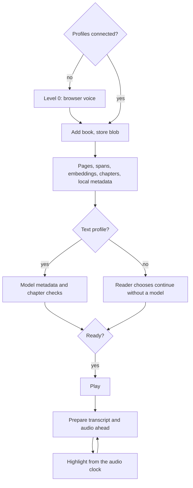
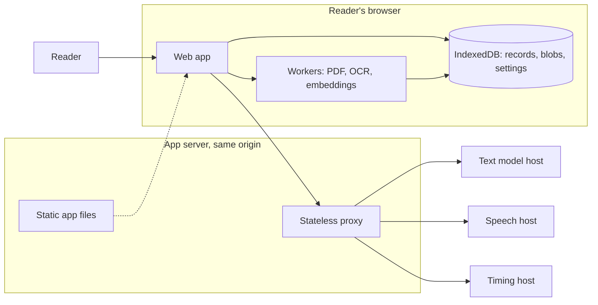
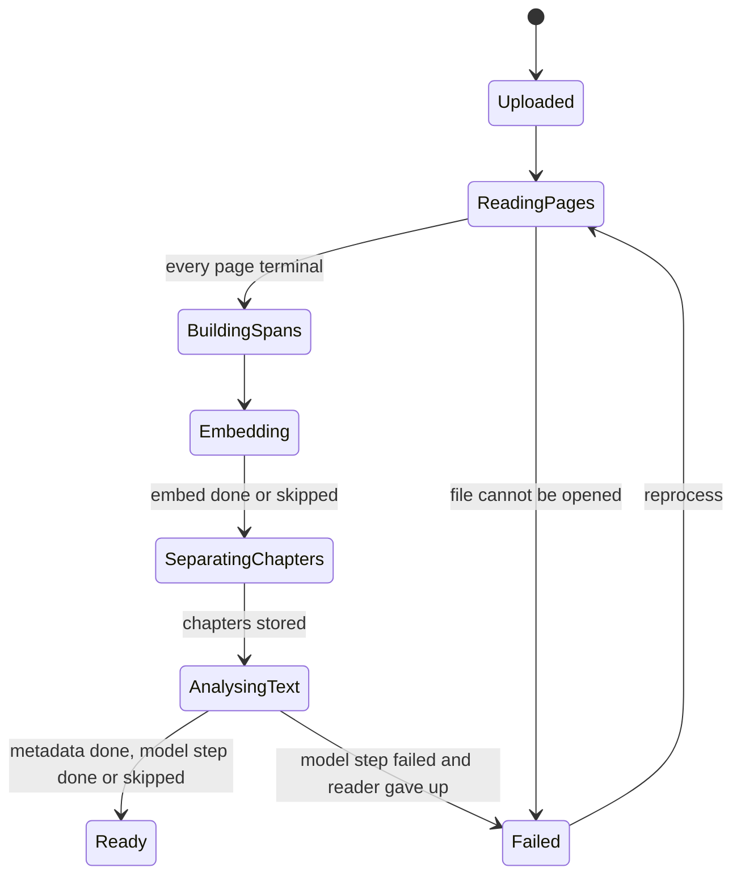
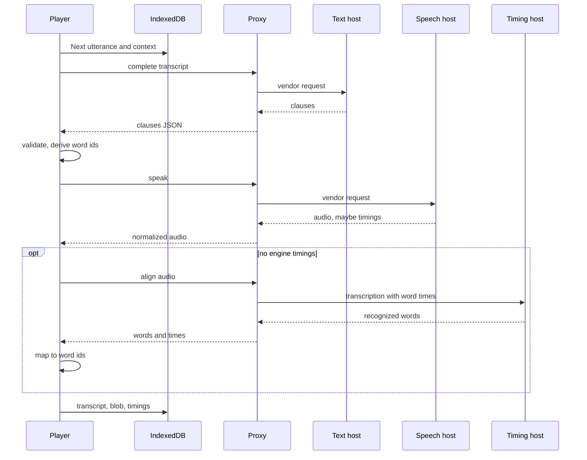
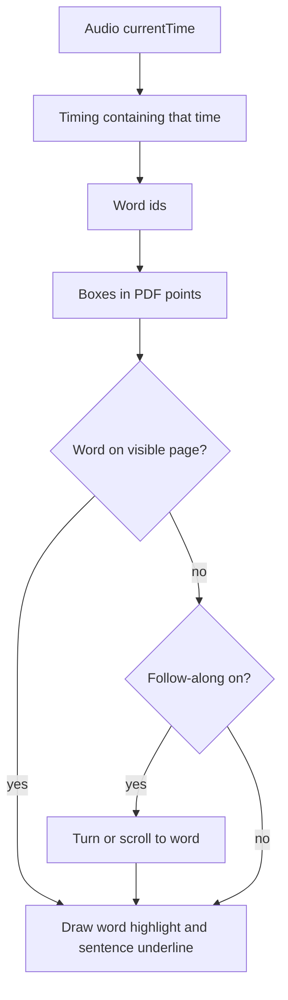
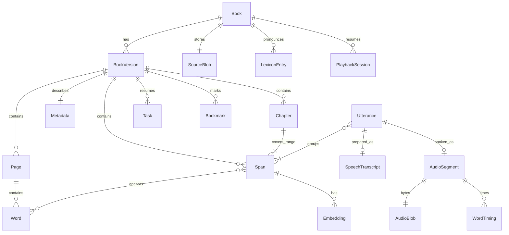

# Open Book Reader — design discussion

Status: discussion. The UI is Svelte and the server is FastAPI. Model vendors stay a proposal. These architecture rules are constraints:

- The browser is the system of record. Book bytes, page and word geometry, chapters, spans, metadata, embeddings, transcripts, audio, playback position, task state, and vendor settings live in IndexedDB. Blob values hold the file and audio bytes.
- The backend that runs transcription, analysis, and completion is a stateless proxy. A request carries the payload and the provider profile. The response is the whole result. The server stores none of the book and none of the settings.
- The browser does not call a vendor origin itself. The proxy forwards to the profile's base URL so a local or remote model host does not have to speak CORS.

Discussion thread: https://github.com/manishsharma004/open-book-reader/issues/1

| Spec file | What it covers |
| --- | --- |
| [`DESIGN.md`](https://github.com/manishsharma004/open-book-reader/blob/main/specs/discussion/DESIGN.md) | This file. Product, pipeline, storage, playback, sizing, acceptance |
| [`PROVIDERS.md`](https://github.com/manishsharma004/open-book-reader/blob/main/specs/discussion/PROVIDERS.md) | Connection settings, proxy contract and deployment, text, speech, and timing vendor tables |
| [`UX.md`](https://github.com/manishsharma004/open-book-reader/blob/main/specs/discussion/UX.md) | Screens, controls, states, accessibility |
| [`REVIEW.md`](https://github.com/manishsharma004/open-book-reader/blob/main/specs/discussion/REVIEW.md) | Design review findings and what changed because of them |

The original request, and where it is answered:

| Request | Where |
| --- | --- |
| User uploads a book | [Upload](#61-upload) |
| Analyse the pages | [Page analysis](#62-page-analysis) |
| Separate the chapters | [Chapter separation](#63-chapter-separation) |
| Analyse the text and create full metadata | [Text analysis and metadata](#64-text-analysis-and-metadata) |
| Audio reading starts only after processing is done | [When play becomes available](#65-when-play-becomes-available) |
| A language model analyses the book in realtime | [Realtime preparation](#72-realtime-preparation) |
| Transcription text for speech, with punctuation and emotion | [Speech transcript](#73-speech-transcript) |
| A speech model reads that transcription | [Speech synthesis](#74-speech-synthesis) |
| Page text highlights in sync with the audio | [Highlight sync](#75-highlight-sync) |
| Data, embeddings, and analysis stay in the browser | [Where work runs](#4-where-work-runs), [IndexedDB](#5-indexeddb-storage-and-task-state) |
| Stateless backend for transcription, analysis, completion | [Stateless proxy](#43-stateless-proxy) |
| Vendor settings, including a remote model URL, stored in the browser and sent on each call | `PROVIDERS.md` |
| Browse books a source already gives away, and keep the chosen file in this browser | [Open books](#611-open-books) |

## 1. Product

A reader adds a book they already have. The browser studies the pages, finds the chapters, reads the text, embeds the speakable passages, and stores a structured description of the book on the device. When that work has finished, the reader may press play.

During playback the browser asks a text model, through the stateless proxy, to prepare the upcoming passage for speech: the words to say, the punctuation that shapes pauses, and an emotion for delivery. A speech model turns that transcript into audio. The browser stores both results locally. The page highlights the words that are sounding at the audio element's current time.

The page the reader sees is the book page. A text view of the same spans is available for small screens and screen readers (see `UX.md`).

### 1.1 What a reader needs to run it

- A current desktop browser: Chromium, Firefox, or Safari. Mobile browsers work for listening with the limits in [Persistence and eviction](#55-persistence-and-eviction) and `UX.md`.
- The app server: one process that serves the web app and the stateless proxy from the same origin, on a machine that can reach the reader's model hosts. `PROVIDERS.md` explains why the proxy and the app should share an origin.
- The app opened from `localhost`, or over HTTPS from other devices. Service workers, Web Locks, and the built-in browser voice need a secure context, and plain `http://192.168.x.x` is not one. Adding a PDF and opening it still work there: the duplicate hash and new ids do not use `crypto.subtle` or `crypto.randomUUID`, and a missing `speechSynthesis` does not replace the reader with an error page. Listening on that address needs a speech model, or HTTPS so the browser voice exists.
- Optionally, a text model and a speech model. The product degrades instead of stopping when either is missing.

| Level | Configured | What the reader gets |
| --- | --- | --- |
| 0 | Nothing | Local analysis, chapters from local signals, local metadata. Listening with the browser's built-in voice and a word highlight that follows the voice. No stored audio, no emotion, no summaries |
| 1 | Speech profile | Stored audio, seek, offline listening for prepared chapters, word highlight from engine timings or a timing profile. Transcript is the printed text with neutral emotion |
| 2 | Text and speech profiles | The full design: emotion and punctuation transcript, summaries, people, pronunciation hints |

The reader can move between levels at any time. Moving up re-queues only the model tasks that were skipped.

### 1.2 What is running

Checked 26 October 2026. The library, settings, reader, and open-book browser are in the app. Spans, embeddings, the Ready gate, and export are not built. The reader stores a chapter list of title and page, which is enough to jump. The span-range chapter model in [Chapter separation](#63-chapter-separation) is still the target. Do not treat a missing piece of that pipeline as a regression.

What the running reader does:

- The PDF, the cover, settings, and an optional voice sample live in IndexedDB `open-book-reader`. The server stores none of them.
- PDF.js draws the page. A page with fewer than 8 text-layer words is read with tesseract.js. Spoken words keep the punctuation that was printed on them.
- Vendor speech is not one request per page. Clips end on a full stop and pack up to the pace in the player, which defaults to 24 words and steps by 4 from 8 to 48. A sentence longer than the pace stays one clip until twice the pace, and never past 64 words. A run with no full stop is still cut at the pace.
- The buffer is the open page plus the next 2 or 3 pages. The open page is filled first. The page is shown when its words are known. Playback starts when the first clip has audio. Words with audio are tinted green.
- Two audio elements are used. The idle one loads the next clip while the current one plays, including the first clip of the next page during the last line. When the last line ends, reading continues on the next page. The last page stops.
- A chapter title on the page is a larger short line, a label such as Chapter 3, or a short line in capitals. It is spoken on its own and marked on the page. A running header, footer, or page number is not spoken.
- Changing the page aborts queued work and the request already in flight. Pocket stops on the next generation step. The proxy answers 499.
- Pace is in the player and in Settings. **Remove sample**, in both places, deletes the saved reference. Later speech uses the voice id.
- The app server on port 7507 serves `apps/web/build` and `/v1`. A web-only change is live after `npm run build` in `apps/web`. Pocket is a separate process on port 7508. Restart a process only when its own code changed.
- **Browse open books** lists the twelve catalogs in [Open books](#611-open-books). Search and download go through the app server. A loader stays up while a catalog responds and while a chosen file is saved in this browser. PDF, plain text, and Project Gutenberg EPUB can be added. Other catalogs still list EPUB without a download. Opening a book in the reader shows the page loader immediately.
- Each book keeps `chapters`: a title, a page index, and nested children when the PDF outline has them. The reader shows that tree beside the page. A click jumps to the page, and the branch that contains the open page is expanded. A contents page of dot leaders is skipped when the outline is missing and headings are read from the text. Opening a PDF replaces a previously flat list with the outline tree.
- An EPUB is drawn from its own HTML, stylesheet, and pictures. The reader pages that document in columns. It does not replace a picture with the description stored on it. Scripts, event handlers, and script URLs in the book are removed before the page is shown, and the frame does not run scripts. Project Gutenberg can be added as EPUB. Other catalogs still list EPUB when the file is not downloaded yet.
- **Two pages** is a toggle. When the page area is wide enough, the open page stays on the left and the next page is shown beside it. Speech, the highlight, and automatic page turns stay on the left page and still advance one page. Previous, Next, and a swipe turn the leaf, two pages at a time. A narrow window keeps one page and remembers the toggle until there is room again.

### In scope for this design

- One reader and the books they add, stored in that browser profile.
- A batch pipeline that must finish (or explicitly skip model steps) before play, and that resumes after a reload.
- Embeddings computed and kept in the browser.
- A realtime path that prepares speech while a ready book plays.
- A sync contract between audio time, spoken words, and page position.
- Book export and import as a file, because the browser is the only copy.

### Out of scope for this design

- Choosing a final model vendor, hosting region, or price.
- Accounts, sync between devices, billing, and paid storefronts. A catalog of books the source already gives away is [Open books](#611-open-books), not a store.
- A server-side library of the reader's books.
- Editing the book's prose.
- Native mobile apps.
- DRM-protected files. The product opens files the reader can already open without a DRM client.

## 2. Reader journey

1. First run asks how the app reaches models. The reader can connect profiles now or skip and stay at level 0.
2. The reader adds a book file. The browser hashes it, offers the existing book if the hash is already in the library, and otherwise writes the file into IndexedDB as **Uploaded**.
3. Processing runs: pages, spans, embeddings, chapters, metadata. Play stays disabled. The reader can page through the PDF while it runs. Progress is stage counts plus an estimate of time left.
4. If a step needs the reader, the task is **blocked** with a reason and an action: enter the PDF password, connect a text model, or continue without one.
5. Closing the tab pauses processing. Opening the app again continues from the task records.
6. The book becomes **Ready**. The reader sees the chapter list, the metadata with found/inferred badges, any uncertain chapter breaks flagged for review, and Play. If a speech profile exists, the first minute at the resume position is already being prepared.
7. Audio plays from stored blobs. The current word is highlighted, and the current sentence is underlined. When the spoken word is on the next page, the page turns.
8. Pause, seek, speed, sentence and chapter jumps, and clicks on a word all move the same audio clock. The highlight reads that clock.
9. Leaving and coming back restores the position from IndexedDB.



## 3. Two uses of the language model

**Batch, before play.** The model confirms chapter boundaries when local signals disagree, writes summaries, lists people, and attaches pronunciation hints. Input is split to fit the text profile's `contextTokens` budget, then merged (see [Text analysis and metadata](#64-text-analysis-and-metadata)). Output is written onto the book version.

**Realtime, after play.** The model receives one utterance (a few sentences) plus a small context the browser assembled, and returns the speech transcript. One call covers all spans in the utterance, not one call per sentence. Output is cached locally. This work is not part of the Ready gate.

The embedding index stays in the browser. A request includes only the few snippets the browser chose.

## 4. Where work runs



### 4.1 In the browser

- Source file, page rasters for OCR, and audio, as blobs.
- Page text, word boxes, reading order, word roles, OCR.
- Spans, embeddings, retrieval.
- The task queue and the book-version state machine.
- Provider profiles, reading settings, playback position, bookmarks, pronunciation fixes.
- Grouping spans into utterances, validating transcripts, mapping words to ids, turning character or recognized-word timings into word timings.
- Rendering pages and drawing highlights.

### 4.2 On the stateless proxy

- Text completion calls for chapters, metadata, and transcripts.
- Speech synthesis, and normalizing the audio container for the browser.
- Speech recognition with word timestamps, for engines that return no timings.
- A probe that checks a profile and lists the host's models.

Each is one request. The proxy writes no database row, no file that outlives the request, no session, and no copy of the profile.

### 4.3 Stateless proxy

| Route | Request | Response |
| --- | --- | --- |
| `POST /v1/complete` | text profile, `kind` (`chapters`, `metadata-map`, `metadata-reduce`, `metadata-front`, `transcript`, or `vision-page`), payload, schema name | JSON for that schema, token usage |
| `POST /v1/speak` | speech profile, compiled speech input, voice, `accept` (audio types this browser can play) | audio, media type, duration, optional timings |
| `POST /v1/align` | timing profile, audio, language, transcript as a recognition prompt | recognized words with start and end times |
| `POST /v1/probe` | one assignment | ok or the vendor error, models or voices, a voice sample, timing support, throughput |
| `GET /v1/health` | none | server version and whether audio conversion is available |

The vendor-specific request shapes, the forwarding and security rules, and the deployment modes are in `PROVIDERS.md`. The running proxy refuses a completion call that is not for Ollama on port 11434, an LLM on port 5173 at `127.0.0.1`, `localhost`, or `192.168.29.45`, or `https://ollama.com`. It refuses a speech call that is not for Kokoro on port 8880 or Pocket TTS on port 7508 at `127.0.0.1`, `localhost`, or `192.168.29.45`, or for OpenAI or ElevenLabs. `OLLAMA_ALLOW` or `SPEECH_ALLOW` can name one extra host.

## 5. IndexedDB storage and task state

IndexedDB is both the store and the pipeline's state. One database per origin. A Web Lock named for the book version makes one tab the writer; other tabs read.

### 5.1 Object stores

| Store | Key | Holds |
| --- | --- | --- |
| `books` | book id | title hint, source hash, current version id, local password if the reader chose to keep it |
| `versions` | version id | state, warnings, book id, chapters revision |
| `pages` | page id | version id, page index, size in PDF points, confidence, extractor, words |
| `spans` | span id | version id, order, role, source word ids, source text, `spoken` |
| `chapters` | chapter id | version id, title, start span order, end span order, source, confidence, `matter` |
| `embeddings` | embedding id | owner id, model id, dimensions, `Float32Array` |
| `metadata` | version id | catalog in [Text analysis and metadata](#64-text-analysis-and-metadata) |
| `lexicon` | entry id | book id, printed term, say-as text, created by reader or model |
| `transcripts` | transcript id | utterance key, clause JSON with derived word ids |
| `segments` | segment id | utterance key, duration, timing quality, blob id |
| `tasks` | task id | version id, kind, status, reason, input ref, heartbeat, error |
| `sessions` | session id | version id, position, rate, voice, style |
| `bookmarks` | bookmark id | version id, word id, note, created time |
| `settings` | `app` | connection and reading settings (`PROVIDERS.md`) |
| `blobs` | blob id | kind, media type, Blob |

Spans do not carry a chapter id. Chapters are ranges over span order, so spans can be built before chapters exist and chapter edits never rewrite spans.

Indexes: pages by `(versionId, pageIndex)`, spans by `(versionId, order)`, tasks by `(versionId, status)`, embeddings by `(ownerId, modelId)`, segments by utterance key, blobs by kind.

### 5.2 Blobs

- `source`: the original file.
- `page-raster`: a rendered page, only while OCR needs it. Deleted after the page is terminal.
- `audio`: one utterance, stored as Opus in WebM or AAC in MP4, whichever this browser reports it can play. About 32 kbps mono.

The proxy asks the engine for Opus or AAC when it offers them, and converts uncompressed output (Gemini TTS returns 24 kHz 16-bit audio) before responding. At 32 kbps a 10.8-hour book is about 155 MB. The same book as 24 kHz 16-bit WAV would be about 1.9 GB, which is why raw output is not stored.

### 5.3 Task state

```json
{
  "id": "task_01",
  "versionId": "bv_01",
  "kind": "metadata-model",
  "status": "blocked",
  "reason": "needs-text-profile",
  "inputRef": null,
  "heartbeatAt": null,
  "error": null
}
```

Statuses: `queued`, `running`, `done`, `failed`, `blocked`, `skipped`. `blocked` always has a reason the UI can act on: `needs-password`, `needs-text-profile`, `needs-speech-profile`, `quota`. `skipped` is only set by an explicit reader choice or by the embedding fallback below.

Kinds, in dependency order: `extract-page` and `ocr-page` (one per page), `build-spans`, `embed-spans`, `chapters`, `metadata-local`, `metadata-model`, `ready-check`. After Ready: `prepare-utterance`, created by lookahead, warm start, or the reader's Prepare action.

The orchestrator takes the version's Web Lock, picks a `queued` task whose dependencies are `done` or `skipped`, marks it `running` with a heartbeat, does the work, writes outputs and `done` in one transaction, and moves on. On load, `running` tasks with a heartbeat older than about 30 seconds return to `queued`.

Processing runs only while the app is open. Workers keep running in a background desktop tab. Mobile browsers suspend background pages, so the processing screen asks to keep the app in front and can hold a Screen Wake Lock while it runs.

### 5.4 Embeddings

A small sentence-embedding model runs in a worker (transformers.js, MiniLM-class, about 20–30 MB quantized for the English model). Weights are fetched once and kept in Cache Storage. A deployment that does not want the browser fetching weights from a model hub serves them from the app server. When the book's language is not English, a multilingual model is used instead, and that choice is stored as the model id on every vector.

Uses: context snippets for realtime transcripts, grouping repeated running headers, comparing candidate headings to their surroundings, and later in-book search.

If the model cannot load, embed tasks become `skipped` with a warning, retrieval falls back to neighboring spans, and Ready is still allowed.

### 5.5 Persistence and eviction

- Call `navigator.storage.persist()` after the first book is added and show the result in Settings → Storage.
- Safari's tracking prevention deletes IndexedDB for a site after 7 days of browser use without interaction with that site. WebKit documents Home Screen web apps as exempt. Safari users are prompted to install the app before their first long processing run.
- Prepared audio is kept up to **200 MB per book** (a full novel at 32 kbps is about 155 MB). Source, pages, spans, embeddings, and metadata do not count toward that cap and are not evicted to free audio space.
- Over the cap, or when the browser quota is short, audio outside the keep window is deleted oldest first. The keep window is the previous chapter, the current chapter, and the next chapter. If those three still do not fit, only the current chapter and the 90-second lookahead are kept.
- Because the browser is the only copy, a book can be exported as one file (records plus source, audio optional) and imported elsewhere. See [Records](#8-records).

## 6. Batch processing

A **book version** is one extraction of one file. Re-extraction creates a new version. Chapter edits and pronunciation fixes do not; they change records inside the version and invalidate only the affected audio.



Playback is session state, not a version state. A version stays Ready while it is being listened to.

### 6.1 Upload

The browser stores the `File` in `blobs`, records name, size, media type, and SHA-256, and creates the page tasks. Nothing calls the proxy. On a secure page the hash uses `crypto.subtle`. On a phone opened at `http://192.168.x.x`, where `crypto.subtle` is missing, the same SHA-256 runs in the page, and ids come from `crypto.getRandomValues`. That page can open the book. The built-in voice is absent there, so Play reports that instead of failing the route.

First format from disk: PDF, text-layer and scanned. A plain-text file from [Open books](#611-open-books) uses the same library record. EPUB reflows, so it needs a fixed pagination before highlights have stable pages; it is a later extractor behind the same interface.

A password-protected PDF blocks with `needs-password`. PDF.js needs the password every time it opens the file, so the reader can keep it in the book record on this device or enter it each session.

### 6.1.1 Open books

Checked 26 October 2026. This is designed and not built.

The reader can browse books that a source already gives away, then keep one file in IndexedDB. That file joins the library through the same upload path as a file from disk: hash, blob, pages, the reader that already exists. The server does not keep the file, the search, or a shelf. There is no account.

Every source is a provider with the same three operations. The browser and the browse screen speak only those operations. Adding a source is a new provider module and a line in the provider list. It is not a new screen, a new route shape, or a new way into the library.

| Operation | Returns |
| --- | --- |
| `list` | id, name, whether search works, languages, a short note |
| `search(q, language, page)` | books, and the next page if there is one |
| `file(id, mediaType)` | the bytes, the media type, and a filename |

A book the browser is allowed to see has provider, id, title, authors, languages, year, `license` (`public-domain` or `open-license`), a short license note, and formats. Each format is a media type, a label, and `addable`. The browser is not given the source URL. A cover is `GET /v1/open-books/{provider}/{id}/cover` on this origin.

`application/pdf` is addable and opens in the reader that exists. `text/plain` is addable because these catalogs usually publish text rather than PDF. The browser paginates that text into pages of about 1,800 characters, breaking on paragraphs, and speaks it with the same clips. The page is text, not a PDF canvas, and the highlight is a span on that text. Project Gutenberg `application/epub+zip` is addable. The browser keeps the EPUB package and draws each section from its HTML, CSS, and images, paged into columns. Other catalogs still list EPUB with `addable: false` until that provider's download exists. The card says so.

A provider returns a book only when that source marks it public domain or under a license that lets the reader keep a copy. Anything else is dropped inside the provider, including borrow-only copies. The browser still refuses a book whose license is neither of those two values.

The registered providers, the hosts each one may contact, and the catalogs that were rejected are in `PROVIDERS.md`. A provider's hosts live only in that module. The proxy will fetch a file only from those hosts. It follows a redirect only when the next host is on that same list, and at most three times. Speech forwarding still does not follow redirects. A fetch is limited to 40 MB and 60 seconds. The query string is not logged.

### 6.2 Page analysis

PDF.js renders the page and returns text items for text-layer PDFs. Items are runs of text, not words. Each item is split into words with `Intl.Segmenter` (word granularity, which also handles languages without spaces), and each word's box is apportioned across the item's width by measuring the substrings with the item's font metrics. Boxes are in PDF user space: points, origin at the bottom-left of the page.

Scanned pages are rendered at a known scale and passed to tesseract.js in a worker with the book's OCR language (asked at upload, defaulting to the browser language). Boxes are converted back to PDF points. Expect several seconds per page on a laptop CPU.

Each page stores index, size, words (text, box, reading-order index, role), confidence, extractor, and warnings.

| Role | Spoken by default |
| --- | --- |
| `prose` | yes |
| `heading` | yes. The chapter title is spoken once. A later heading with different text is spoken. A repeat of a heading already spoken in that chapter stays silent. **Speak headings** defaults on |
| `footnote`, `caption` | no, until enabled in reading settings |
| `header`, `footer`, `page_number`, `table`, `unreadable` | no |

Reading order: PDF.js returns items in content-stream order, which is usually but not always reading order. Columns are detected by clustering line starts. Pages where the order is uncertain get a warning that the reader can see on that page. Line-end hyphenation is joined into one spoken word that keeps both boxes.

OCR words below a confidence threshold (start at 60 of 100) are `unreadable` and not spoken. A vision retry sends the page image to the text profile once. It is off unless the reader turns on **Send unreadable pages to the text model** for that book, because the image leaves the device. If the page still fails, playback shows a marker where the page would be read.

A table is not spoken. When playback reaches one, the player shows **Table, not read** on that region and continues at the next spoken span. Reading tables is not a setting in this version.

### 6.3 Chapter separation

The running reader already stores a title and a page index, from the PDF outline or from headings, and jumps to that page. This section is the target beyond that list.

A chapter is a title plus a half-open range of span order. Ranges do not overlap and, with skipped matter, cover every spoken span.

Signals, strongest first:

1. The PDF outline (bookmarks) from `getOutline()`. Each entry with a destination gives a page and position.
2. A printed table of contents with page numbers.
3. Heading words (`Chapter`, `Part`, numbered headings, large type followed by prose).
4. Embedding comparison, to drop running headers that look like titles.
5. A text-model check, only when the signals above disagree. The request carries candidates and TOC text. Every returned boundary must cite a word id. Unanchored boundaries are dropped.

With no text profile, step 5 is skipped and the best local result is used with its confidence; chapters never block Ready. If nothing is found, the book is one chapter with a warning.

Chapters store title, span range, confidence, `source` (`outline`, `toc`, `heading`, `embedding`, `model`), and `matter` (front or back). The reader reviews uncertain breaks after Ready, from the book home. Review is not part of the gate, so play is not held for it. An edit increments the chapters revision and drops cached utterances that touch a changed boundary. The first heading span of a chapter is spoken with the chapter; a later repeat of that heading is treated as a running header and stays silent.

### 6.4 Text analysis and metadata

**Local, always.** `metadata-local` reads the PDF information dictionary and XMP (`getMetadata()`), the title and copyright pages, and computes structure: page count, chapter tree, word count, spoken word count, listening time at the current speed.

**Model, when a text profile exists.** `metadata-model` runs map and reduce steps so a small context window works:

1. Map: for each chunk that fits the text profile's `contextTokens` (minus the prompt and output budget), return a short summary, people and places with the span ids that mention them, and pronunciation candidates.
2. Reduce: merge people across chunks by name and alias, write per-chapter summaries from chunk summaries, then the book synopsis from chapter summaries.
3. Bibliographic fields not found locally are requested from the front-matter pages only.

Without a text profile, `metadata-model` is blocked with `needs-text-profile` until the reader connects one or chooses Continue without a model, which marks it `skipped`.

Catalog:

- Bibliographic: title, subtitle, authors, language and script, publisher, place, year, ISBN, edition.
- Structure: page count, chapter tree, word counts, listening time.
- Understanding: short and long synopsis, per-chapter summary, people (name, aliases, one-line description, pronunciation), places and proper nouns needing pronunciation, optional content notes tied to spans.
- Quality: pages by extractor, unreadable pages, uncertain reading order, low-confidence chapter breaks, skipped steps, fields left unknown.

Every value has provenance, `found` or `inferred`, with word ids and a confidence. Fields not in the book stay unknown. The model must not supply an author, year, or ISBN from outside knowledge. The reader can edit any field; edits are marked `reader`.

The detected language selects the default voice language and the embedding model.

### 6.5 When play becomes available

A version is **Ready** when:

1. Every page is terminal (including unreadable pages).
2. Spans exist and each points at words.
3. Embed tasks are done or skipped.
4. Chapters are stored with anchored, non-overlapping ranges covering the spoken spans.
5. `metadata-local` is done.
6. `metadata-model` is done or skipped by the reader. A failed or blocked model step keeps the book not Ready, with the reason shown.

Chapter review, transcripts, and audio are not part of the gate. Play is offered only after every chapter has finished processing. That is the original request.

After Ready, a `prepare-utterance` warm start begins at the resume position when a speech profile exists, so the first press of Play is usually immediate.

### 6.6 The speakable span

A span is a short run of words in reading order, usually a sentence: id, version id, order, role (`narration`, `dialogue`, `heading`), source word ids, source text with hyphenation resolved and punctuation as printed, and `spoken`. Spans contain no headers, footers, or page numbers. Spans are immutable within a version.

## 7. Listening session

### 7.1 Position

`(version_id, segment_id, offset_ms)` once audio exists, otherwise `(version_id, span_id, word_id)`. Saved on pause, on chapter change, and every few seconds while playing.

### 7.2 Realtime preparation

**Utterances first.** The browser groups consecutive spoken spans into utterances: about 8–25 seconds at 155 words per minute, never across a chapter boundary, under the speech vendor's input limit (for example 4,096 characters on OpenAI's speech route), and split where the vendor can only apply one emotion per request (see [Speech synthesis](#74-speech-synthesis)). The utterance key is `(version_id, chapters_revision, span_ids, text_profile_id, text_model, speech_profile_id, speech_model, voice, style, lexicon_hash)`.

**Lookahead in seconds.** Keep at least 90 seconds of prepared audio ahead of the playhead, measured at the current playback rate, with at most two utterances in flight. The browser tracks how many seconds of audio it produces per second of wall time. If that falls below the playback rate, the player says the voice is slower than playback and offers to lower the speed or prepare the chapter ahead.

**Per utterance:**

1. Load the utterance's spans, the previous utterance's transcript, the next span's text, the chapter summary, the people and pronunciation sheet, the reader's lexicon, and a few retrieved snippets.
2. With a text profile: `POST /v1/complete` (`kind: transcript`). Without one: the fallback transcript.
3. Validate each span's clauses and derive word ids (next section). Failed spans fall back individually.
4. Compile the clauses for the speech vendor and `POST /v1/speak`.
5. If the response has no timings, `POST /v1/align` with the timing profile. Without a timing profile, mark the segment `coarse`.
6. Store transcript, audio blob, and timings in one transaction.

A jump drops in-flight work that is no longer near the playhead; the browser ignores those responses. If the current utterance is not ready, the player shows **Preparing** with the reason. After repeated failures it offers plain reading (fallback transcript) or the browser voice, rather than waiting indefinitely.



### 7.3 Speech transcript

The model returns clauses per span and nothing else:

```json
{
  "spans": [
    {
      "span_id": "sp_0142",
      "clauses": [
        { "text": "Stop,", "emotion": "tense", "role": "dialogue", "speaker": "Mara", "pause_after_ms": 180 },
        { "text": "she said.", "emotion": "somber", "role": "narration", "speaker": null, "pause_after_ms": 280 }
      ]
    }
  ]
}
```

The browser derives `source_word_ids` by walking the span's printed words in order and matching each clause's content words. The model does not produce word ids, because small models reliably get ids wrong and the browser already knows the mapping.

Rules:

- Punctuation may be added or changed. Content words may not be added, removed, or replaced. Comparison is case-folded with punctuation separated from words.
- `emotion` is one of `neutral`, `calm`, `warm`, `tense`, `somber`, `excited`, `whispered`, `angry`; anything else becomes `neutral`.
- `speaker` must be on the people list or null.
- `pause_after_ms` is capped at 800.
- A span that fails becomes one clause: its printed text, `neutral`, no pause.

Emotion is never drawn on the page. Engines express it differently: an instructions string per request, a style element per sentence, inline tags, or not at all. `PROVIDERS.md` has the mapping per vendor. Reader pronunciation fixes from `lexicon` are applied when compiling for the engine, after validation, so validation always compares against the printed words.

### 7.4 Speech synthesis

Emotion granularity depends on the engine:

| Granularity | Example engines | Utterance rule |
| --- | --- | --- |
| Clause | Azure style elements, ElevenLabs audio tags, Gemini per-part style | Group freely |
| Request | OpenAI `instructions` | Split utterances where the dominant emotion changes (intensity `full`), or use the utterance's dominant emotion (intensity `subtle`). Intensity `off` sends a neutral instruction |
| None | Kokoro, Google Cloud TTS, browser voice | Group freely; punctuation carries delivery |

Timings, best first:

1. **Engine word timings** (Kokoro captioned speech, Google SSML marks, Azure word boundaries).
2. **Engine character timings** (ElevenLabs): the browser sums characters into words and drops inline tag characters.
3. **Recognized-word timings** from `/v1/align`: the browser aligns recognized words to the transcript words with an edit-distance alignment that tolerates recognition errors and spoken numbers, and interpolates unmatched words between their matched neighbors.
4. **Coarse**: the whole utterance highlights for its duration. Shown in the UI as sentence-level highlight.

### 7.5 Highlight sync

The audio element is the clock when the page has stored audio. `currentTime` and the segment's word timings select the word. Rate, pause, and scrubbing act on that element. Pause leaves `currentTime` where it is, and Play continues from that sample. Word highlight is required when the segment has word timings. When it does not, the same per-word estimate used by the browser voice is spread across the clip, so one word is still marked. Sentence highlight remains the coarse fallback for a segment that has neither timings nor a word list.



- Read `currentTime` on each animation frame while playing, and on `seeked` and `ratechange`. Between words, keep the previous word highlighted.
- Two audio elements alternate: the next segment is loaded into the idle one and started on `ended`, so segment changes have minimal gaps. If gaps or lock-screen chaining prove unreliable, switch to one element fed by Media Source Extensions (ManagedMediaSource on iOS).
- If the reader scrolls or turns pages manually, follow-along pauses and a **Back to reading position** control appears.
- Clicking a word seeks to it, preparing its utterance first if needed.
- Speed range 0.5–3.0 with pitch preserved (`preservesPitch`).
- Media Session metadata and actions expose title, chapter, cover (first page), play, pause, and skip on lock screens and headphones.

### 7.6 Worked example

Page 3, one span `sp_3_1`: "Mara waited. The station clock had stopped at noon." Words w1–w9 with boxes in PDF points, for example w4 "station" at `(100, 622, 48, 12)`.

The model returns two clauses: "Mara waited." (`calm`) and "The station clock had stopped at noon." (`somber`). The browser matches content words in order and derives w1–w2 and w3–w9.

The speech host returns 4.2 s of audio and no timings. `/v1/align` returns recognized words with times; "noon" is recognized as "new" but still aligns by position and neighbors. Resulting timings include w4 at 1.62–2.10 s.

At `currentTime = 1.80` the word **station** is highlighted and the whole sentence is underlined. A click on **noon.** seeks to its start time. At rate 1.5 the same boundaries apply, because they are positions in the audio's own timeline.

### 7.7 Browser voice (level 0)

With no speech profile, the player uses `speechSynthesis` for the page, starting at the current word. Audio cannot be captured or stored, so there is no offline listening. The UI labels this mode as a preview voice.

Opening the reader does not require that engine. On a phone at `http://192.168.x.x` it is missing. The page still opens. Play leaves the page on screen and says the browser voice is unavailable. A speech model in Settings is how that phone listens. `localhost` and HTTPS still have the engine.

The highlight does not wait for a `boundary` event. Many voices, including Chrome on Linux and Android and some network voices, never send one. Each word gets a duration from its length, its trailing punctuation, and the speech rate. An animation frame moves the mark when that duration elapses. A `boundary` event with `charIndex`, when the engine does send one, snaps the clock to that word so the estimate cannot drift.

Pause stops the voice and leaves the current word marked. Play speaks from that word through the rest of the page. The browser cannot freeze a sample mid-word, so the current word is spoken again from its start. Clicking a word starts at that word. A page change clears the position.

The browser voice can still mark emotion. Each named emotion changes pitch, rate, and volume, and the player says that this is not model expression. A chosen emotion applies to the page. **Auto** asks the emotion model, or the VLLM profile when emotion analysis is off, for clause emotions. With no model, auto stays neutral.

### 7.8 Page buffer

The reader prepares the visible page and a fixed number of following pages, 2 or 3, chosen in settings. That window is the buffer. Seeking to a page that is not ready shows **Buffering**, with the step in progress, and playback waits for that page. Pages outside the window are dropped from the queue. The 90-second utterance lookahead above remains the target once stored audio exists; this page window is what the reader runs before that audio exists.

Vendor speech is not one request per page. Each page in that same window is split on full stops. Short sentences pack up to the pace chosen in the player, which defaults to 24 words. A sentence longer than that pace stays one clip until it reaches twice the pace. A run with no full stop is still cut at the pace, because Pocket is trained for about 50 tokens and a whole page with no end mark otherwise runs to its maximum length. The open page is spoken first, then the following pages, until the window is full. The spoken line keeps the punctuation from the page, so a comma or a full stop is still in the transcript and the voice can pause there. The page is shown as soon as its words are known. Emotion analysis does not hold that up. Playback starts when the first clip is ready, while the rest of the window is still buffering. The next clip is loaded while the current one plays, and it starts as soon as the current one ends. When the last line of a page finishes, reading continues on the next page, and the first line of that page is loaded during the last line of this one. A chapter title is a larger short line, or a line such as Chapter 3, and it is spoken by itself with a pause after it. Those words stay marked on the page. A running header, footer, or page number is left unspoken. Words whose clip is already audio are tinted green. A loader stays on the page while that page still has a clip in progress. Changing the page aborts speech and emotion requests for the page that was left, including a clip that is already generating, so the next page gets the speech service immediately.

A page with fewer than 8 text-layer words is read with tesseract.js in the browser. English trained data ships with the app. The language code is a setting. Word boxes from OCR are converted back into PDF space so the highlight sits on the page image.

Each step is written to the pipeline log on the reader: text layer, OCR, emotion, speech, and buffer. The log records status, duration, host, model, and the text or error. It does not record API keys.

## 8. Records



Utterances are identified by their key and are not stored as their own rows; transcripts and segments carry the key.

**Book export** writes one file: a zip with `book.json` (book, version, pages, spans, chapters, metadata, lexicon, bookmarks, session), the source file, and optionally the audio blobs with their segments and timings. Embeddings are left out and recomputed on import, which keeps the file small. Import checks the source hash and offers to merge into an existing book with the same hash.

## 9. Failure behavior

| Situation | Behavior |
| --- | --- |
| File cannot be opened | Version Failed with the reason. The reader can remove it |
| PDF needs a password | Task blocked `needs-password`. Pages wait |
| DRM-protected file | Failed with a message that DRM files are not supported |
| Tab closed mid-pipeline | Done tasks stay done. Stale running tasks return to queued |
| OCR page fails | Page unreadable. Playback shows a marker and continues |
| No text profile at metadata | Blocked `needs-text-profile`, with Connect and Continue without a model |
| Model returns invalid JSON | One retry with the validation error in the prompt, then the task fails with the vendor text shown |
| Model call fails or host unreachable | Task returns to queued with the error. The reader fixes settings and resumes |
| Embedding model cannot load | Embed skipped, neighbor-span context, Ready allowed |
| Transcript fails validation | That span uses the fallback clause |
| Speech call fails | Preparing, retries with backoff, then offers plain reading or the browser voice |
| No timings and no timing profile | Segment `coarse`, sentence highlight |
| Voice slower than playback | Hint to lower speed or prepare ahead |
| Storage quota exceeded | Evict audio outside lookahead. If still full, block new audio with `quota` and show Storage settings |
| Safari storage cleared after inactivity | Library is empty. Prevent with install prompt and book export reminder |
| Reprocess during listening | The open session keeps its version until the reader switches |
| Two tabs | One writer per version. The other shows progress |

## 10. Privacy and security

At rest, the book exists only in IndexedDB. Each model call sends only what that call needs:

| Call | Leaves the device |
| --- | --- |
| Chapter check | heading candidates and TOC text |
| Metadata map and reduce | chunk text, then chunk summaries |
| Transcript | utterance text and a small context |
| Speech | transcript text plus emotion directions |
| Align | one utterance's audio |
| Vision retry (opt-in) | one page image |
| Every call | the profile for that call, including its API key |

API keys are stored in plain form in IndexedDB, readable by any script running on the app's origin. The app therefore ships with a strict Content Security Policy and no third-party scripts. Settings export leaves keys out unless the reader ticks Include API keys. The proxy's own protections (origin and host checks, token, forwarding allowlist, no body logging) are in `PROVIDERS.md`.

## 11. Settings that change output

Connection settings and profiles are in `PROVIDERS.md`. Reading settings live in the session and in `settings`:

| Setting | Changes cached audio |
| --- | --- |
| Voice | yes |
| Emotional intensity (`off`, `subtle`, or `full`) | yes |
| Footnotes and captions spoken | yes, for affected utterances |
| Speak headings (default on) | yes, for utterances that contain a heading |
| Pronunciation fixes | yes, for utterances containing the term |
| Speed | no |
| Highlight color, follow-along, view mode, Day / Night / System | no |

## 12. Suggested stack

```text
apps/web     Svelte 5, SvelteKit (adapter-static), TypeScript, Tailwind CSS 4, shadcn-svelte
apps/server  FastAPI: serves the web build at / and the proxy at /v1, no database
specs/       design discussion
```

| Concern | Choice | Why |
| --- | --- | --- |
| Reader UI | Svelte 5, SvelteKit, TypeScript | Client-only app; storage is IndexedDB. SvelteKit is how shadcn-svelte is meant to be installed |
| Server output | `@sveltejs/adapter-static`, FastAPI serves `apps/web/build` | One process. The app has no SvelteKit server routes and no second backend |
| Components | Tailwind CSS 4 and shadcn-svelte | Buttons, dialogs, sheets, menus, inputs, and toasts are copied into `$lib/components/ui`. The page highlight is custom, because it draws PDF boxes |
| Theme | Ink by default, Lamp kept | Ink is cool gray and ink blue. Lamp remains the warm paper palette |
| Offline shell | Service worker | Library and prepared chapters open without the server |
| PDF render and text | PDF.js | One library for the drawn page and the stored boxes |
| Word splitting | `Intl.Segmenter` | Word boundaries in any language |
| OCR | tesseract.js in a worker | Local OCR with language packs |
| Embeddings | transformers.js in a worker | Local vectors |
| Storage | IndexedDB via `idb`, Web Locks, `navigator.storage` | Records, blobs, single writer, persistence |
| Book export | fflate | Zip in the browser |
| Playback | Two `<audio>` elements, Media Session API | Small gaps, lock-screen controls |
| Preview voice | Web Speech `speechSynthesis` | Listening with no profiles |
| Server | Python 3.12, FastAPI, httpx, uvicorn | Same-origin app and stateless proxy. Static files at `/`, proxy at `/v1`, SPA fallback to `index.html` |
| Audio normalization | ffmpeg per request on the server | WAV and PCM to Opus or AAC; nothing kept |
| Packaging | Compose file: app server plus Kokoro as a second service | Level 1 works with no account. Kokoro is not inside the app image |

The server must not grow a book table, user table, settings table, job queue, object storage, sticky sessions, or vendor keys of its own.

The recommended compose file runs two services. `web` is the app server. `kokoro` is Kokoro-FastAPI, reachable from `web` and not published to the host. The speech profile's `baseUrl` points at that service, and the browser still only calls `/v1`. Kokoro keeps nothing of the book between requests. A text model is not bundled; the reader points a text profile at Ollama or a hosted vendor. OpenAI's current speech models are not the default: they are listed to shut down on January 6, 2027, and they return no word timings. Kokoro returns word timings, so the default setup needs no timing profile. Kokoro cannot clone a voice. On an 8GB GPU the text model already needs the card, so the clone engine is Kyutai Pocket TTS `english_18m_refl_2026-10` (20 October 2026): 18.2M parameters, about 10× realtime on one CPU thread, a wav sample as the voice. In this container the Pocket process uses the CPU wheel of PyTorch while it is on the CPU, because the ROCm wheel's CPU kernels are several times slower. It uses ROCm PyTorch `2.14.0+rocm10.1.0` with gfx1012 kernels on the RX 5500M when that card has at least 1 GB free. The browser builds the clips in [What is running](#12-what-is-running). Pocket itself still breaks only on sentence punctuation, so a page sent as one request with no full stop runs to the model's maximum length and can pass the proxy's 90 second limit. It does not return word timings, so highlight uses the per-word estimate. Pocket runs as its own process, the same way Kokoro does, and the proxy forwards speech to it on port 7508. Port 7508 is inside the 7500–7510 range this container publishes. A saved sample is sent as `voice_wav`. A builtin voice name is sent as `voice_url`. The proxy does not forward a voice URL for Pocket to fetch. ElevenLabs is not the cloning path for this machine. One voice speaks narration and dialogue. The transcript's `speaker` is kept for a later second voice and does not select a voice now.

### 12.2 Ink and Lamp

Ink is the default palette. Day is cool paper and ink blue. Night is a blue-black with a light ink primary. Lamp stays available: warm paper and walnut by day, warm charcoal and brass at night. The choice is `ink` or `lamp` in settings and on the reader, stored as `obr-palette`, separate from Day / Night / System. Both palettes use the same type and the same highlight treatment, with the highlight color following the palette.

### 12.1 Lamp theme

shadcn-svelte is the community Svelte port of shadcn. New projects use its `new-york` style, Tailwind 4, and OKLCH tokens. Lamp replaces the neutral base color with a reading palette. Tokens live in the global stylesheet as CSS variables, mapped with `@theme inline`, and `.dark` on `<html>` switches night. The choice is stored in settings. The first visit follows `prefers-color-scheme` until the reader picks Day, Night, or System from the text-size menu.

Chrome (library, settings, player bar) uses the tokens below. The text view uses the reading surface, which is warmer and sets Literata. UI text uses Source Sans 3. Both fonts are files of the app, so they stay inside the existing `default-src 'self'` policy.

| Token | Day | Night |
| --- | --- | --- |
| background | `oklch(0.97 0.015 95)` paper | `oklch(0.23 0.015 65)` warm charcoal |
| foreground | `oklch(0.32 0.03 65)` ink | `oklch(0.93 0.015 95)` |
| card | `oklch(0.985 0.008 95)` | `oklch(0.27 0.015 65)` |
| primary | `oklch(0.40 0.06 55)` walnut | `oklch(0.80 0.08 85)` brass |
| primary-foreground | `oklch(0.97 0.01 95)` | `oklch(0.25 0.03 65)` |
| muted-foreground | `oklch(0.48 0.025 65)` | `oklch(0.74 0.02 90)` |
| border | `oklch(0.88 0.02 90)` | `oklch(0.36 0.015 65)` |
| ring | `oklch(0.62 0.10 75)` | `oklch(0.75 0.09 85)` |

Radius is `0.5rem`. The reading surface is `oklch(0.965 0.02 95)` by day and `oklch(0.25 0.02 65)` at night, with Literata at `1.125rem`, line height `1.65`, and a measure of `66ch`.

The spoken-word mark is an overlay on the PDF, so it is not a shadcn token. Default word fill is `oklch(0.86 0.13 88 / 50%)`, an amber pen, with a `2px` walnut underline `oklch(0.46 0.08 55)` on the sentence. The underline is the cue that stays visible if the fill is faint on the page. The high-contrast preset uses fill `oklch(0.78 0.15 80 / 70%)` and a `2px` outline `oklch(0.32 0.05 55)`. The reader can still change the highlight color in reading settings. Day and Night do not change cached audio.

Interfaces:

```text
PageExtractor.extract(blob) -> pages and words              // browser
Embedder.embed(spans) -> vectors                            // browser
Retriever.nearest(vector, k) -> snippets                    // browser
complete(profile, kind, payload) -> JSON                    // POST /v1/complete
speak(profile, input, voice, accept) -> audio, timings?     // POST /v1/speak
align(profile, audio, language) -> recognized words         // POST /v1/align
```

## 13. Sizing

Estimates for a 400-page novel, to check that the design fits real devices and vendors. Assumptions: 250 words per page, 1.3 tokens per word, 155 spoken words per minute, utterances of about 20 seconds.

| Quantity | Estimate |
| --- | --- |
| Words / characters / tokens | about 100,000 / 600,000 / 130,000 |
| Listening time at 1.0× | about 10.8 hours |
| Spans (sentences) | about 6,500 |
| Utterances | about 2,000 |
| Transcript calls | about 2,000, each roughly 1,000 tokens in and 150 out, so about 2 million input tokens per full listen |
| Speech calls | about 2,000, about 600,000 characters per full listen |
| Align calls | up to 2,000 when the engine returns no timings |
| Metadata map calls | about 50 with a 4k-token context, about 5 with a 32k context |
| Stored audio | about 155 MB at 32 kbps for the whole book; only the prepared parts are stored |
| OCR (scanned book) | several seconds per page on a laptop CPU, so tens of minutes for 400 pages |
| Embeddings | a few minutes for 6,500 spans in a worker |

The UI shows the character and token counts before the reader prepares a whole book or chapter, so cost is visible with any vendor.

Realtime prep has to produce 20 seconds of audio in under 20 seconds divided by the playback rate. A hosted text model and hosted speech usually take a few seconds per utterance. A local 8B model on a consumer GPU plus Kokoro is usually within budget at 1.0×. CPU-only local setups often are not, which is why the throughput hint and Prepare ahead exist.

## 14. Decisions

These were open questions. They are decided.

| # | Decision | Where it lives |
| --- | --- | --- |
| 1 | The first upload is PDF only. EPUB waits on a pagination step that can give stable pages | [Upload](#61-upload) |
| 2 | Play waits until the whole book passes the Ready gate | [When play becomes available](#65-when-play-becomes-available) |
| 3 | The chapter heading is spoken once, at the start of the chapter. **Speak headings** defaults on. Running headers stay silent | [Page analysis](#62-page-analysis) |
| 4 | One word is highlighted while the voice runs. Engine timings win. Otherwise the highlight follows a per-word estimate, and a browser boundary snaps it. Pause keeps that word; Play continues from it | [Highlight sync](#75-highlight-sync), [Browser voice](#77-browser-voice-level-0) |
| 5 | One voice speaks at a time. Kokoro is the preset voice. A cloned voice on an 8GB machine uses Kyutai Pocket TTS `english_18m_refl_2026-10`. This container runs it on the RX 5500M when that card has at least 1 GB free, and on the CPU otherwise. The proxy sends the sample as `voice_wav` to that service on port 7508. ElevenLabs is not the cloning path. `speaker` is stored and does not select a voice | [Suggested stack](#12-suggested-stack), [Page buffer](#78-page-buffer) |
| 6 | Prepared audio is kept up to 200 MB per book. Under pressure the previous, current, and next chapters are kept and older audio is dropped | [Persistence and eviction](#55-persistence-and-eviction) |
| 7 | Uncertain chapter breaks are reviewed after Ready. The flag does not block play | [Chapter separation](#63-chapter-separation) |
| 8 | Tables are not spoken. Playback shows **Table, not read** and continues | [Page analysis](#62-page-analysis) |
| 9 | Vision retry is off until the reader opts in for that book, because it sends a page image | [Page analysis](#62-page-analysis) |
| 10 | Kokoro is the default speech engine. Hosted alternatives with timings are Google Cloud TTS and ElevenLabs. OpenAI speech is not the default | [Suggested stack](#12-suggested-stack) |
| 11 | The recommended compose file runs Kokoro as its own service next to the app server. The app image does not contain the speech weights, and no text model is bundled | [Suggested stack](#12-suggested-stack) |
| 12 | The running reader speaks short clips for the open page and the pages ahead, and play starts on the first clip. The span pipeline and the Ready gate stay the target and are not what the app does today | [What is running](#12-what-is-running), [Page buffer](#78-page-buffer) |
| 13 | Open books are providers with one interface. A new source is a module. PDF and plain text can be kept; EPUB is listed and not addable yet. Only public-domain and open-license files are returned | [Open books](#611-open-books), `PROVIDERS.md` |

## 15. Follow-up discussions

- IndexedDB stores, task statuses and reasons, Web Lock, export format.
- Page extractor: word splitting, box apportioning, column detection, OCR languages.
- Utterance grouping, emotion granularity, and the lookahead budget.
- Transcript schema, word-id derivation, and validation.
- Timing sources and the recognized-word alignment.
- Proxy contract, deployment modes, and security (`PROVIDERS.md`).
- Screens and accessibility (`UX.md`), including the spoken recap on resume, which reuses chapter summaries and the speech assignment.
- Prototype measurements that decide the riskier choices (`REVIEW.md`).

## 16. Acceptance for a later implementation

With a short PDF we have rights to use:

1. File, pages, spans, embeddings, chapters, and metadata are in IndexedDB after processing. The server has no book record.
2. Ready is reached only after the gate in [When play becomes available](#65-when-play-becomes-available). With no text profile, Ready is reached only after the reader chooses Continue without a model.
3. Reloading mid-processing resumes from task records without asking for the file again.
4. At a paused `currentTime`, the highlighted boxes are the words whose timings contain that time.
5. Seeking moves the highlight. Clicking a word seeks the audio.
6. A page turns during continuous audio because the next word is on the next page; with follow-along off, it does not.
7. A transcript that changes content words is rejected for that span, and the printed sentence is spoken.
8. Model output contains no word ids; stored transcripts do.
9. Deleting an audio blob and playing again rebuilds it through the proxy.
10. Editing a chapter boundary drops only utterances touching that boundary.
11. The network log shows model calls going to the app server origin, not to vendor hosts.
12. A book exported in one browser and imported in another plays from the same position.
13. Level 0 plays with the browser voice. The highlighted word advances while the voice runs, including when the browser sends no word boundaries. Pause leaves that word marked, and Play speaks from it.
14. With Kokoro, pause keeps `currentTime` and the highlighted word. Play continues from that sample. A clip with no word times still marks one word by spreading the per-word estimate across the clip.
15. Playback skips a table and shows **Table, not read**. The chapter heading is spoken once.
