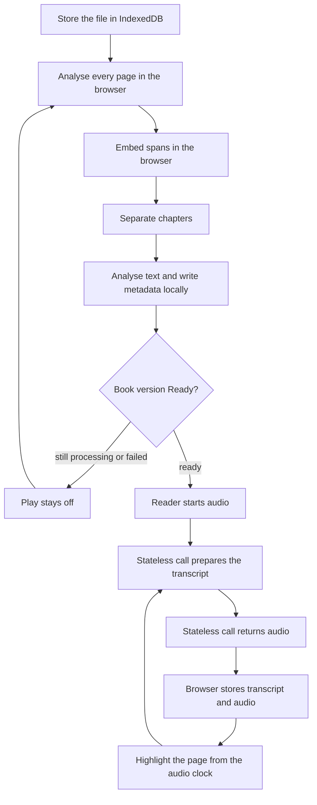
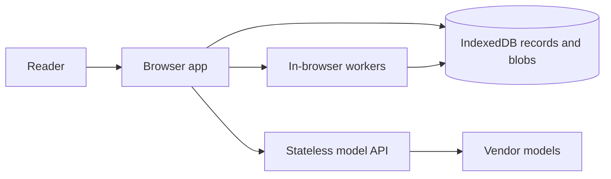
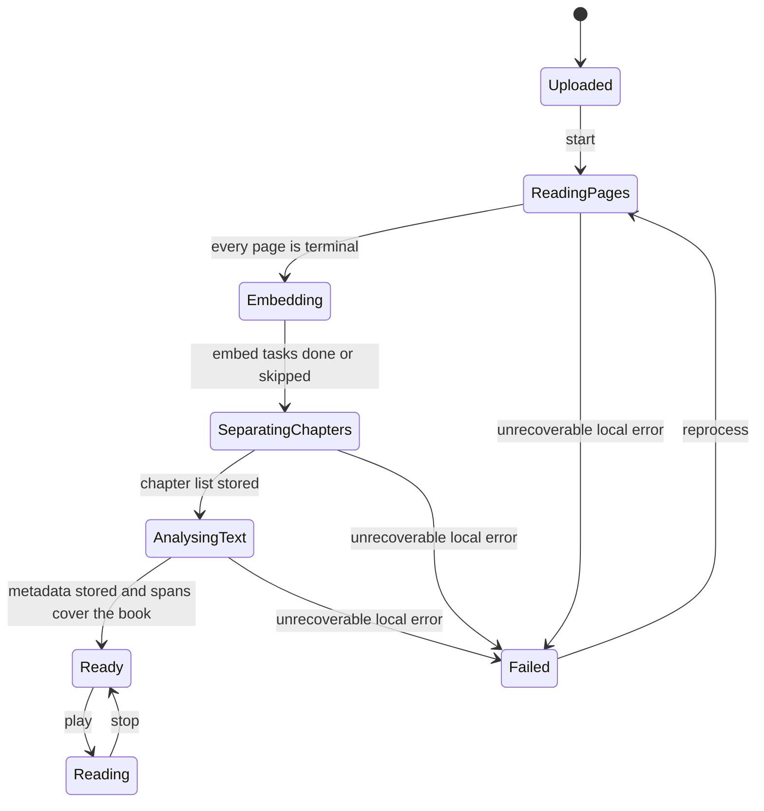
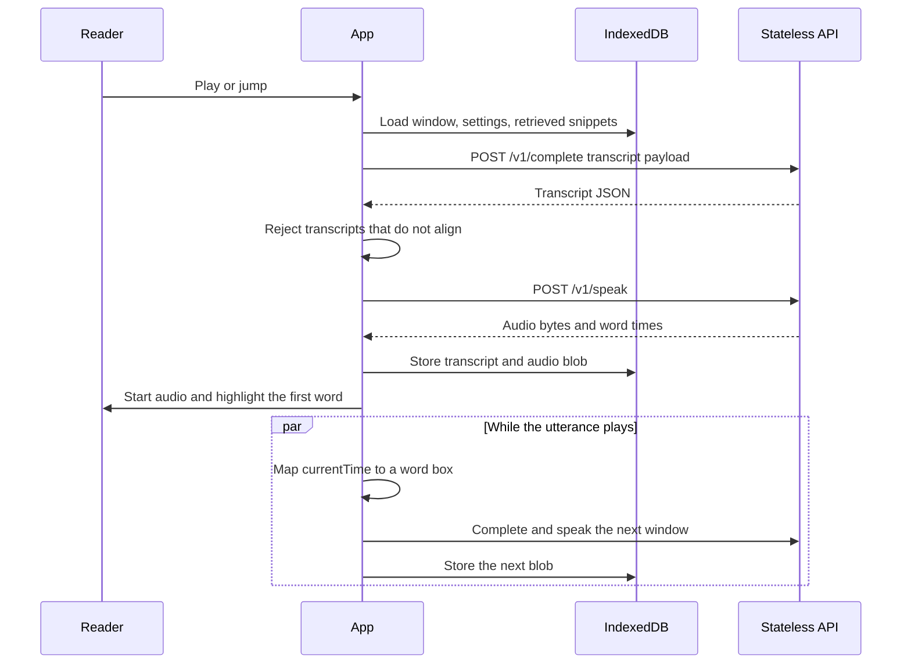
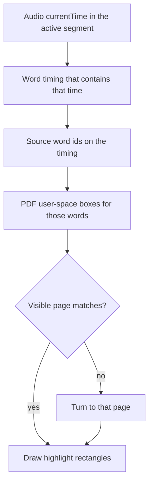
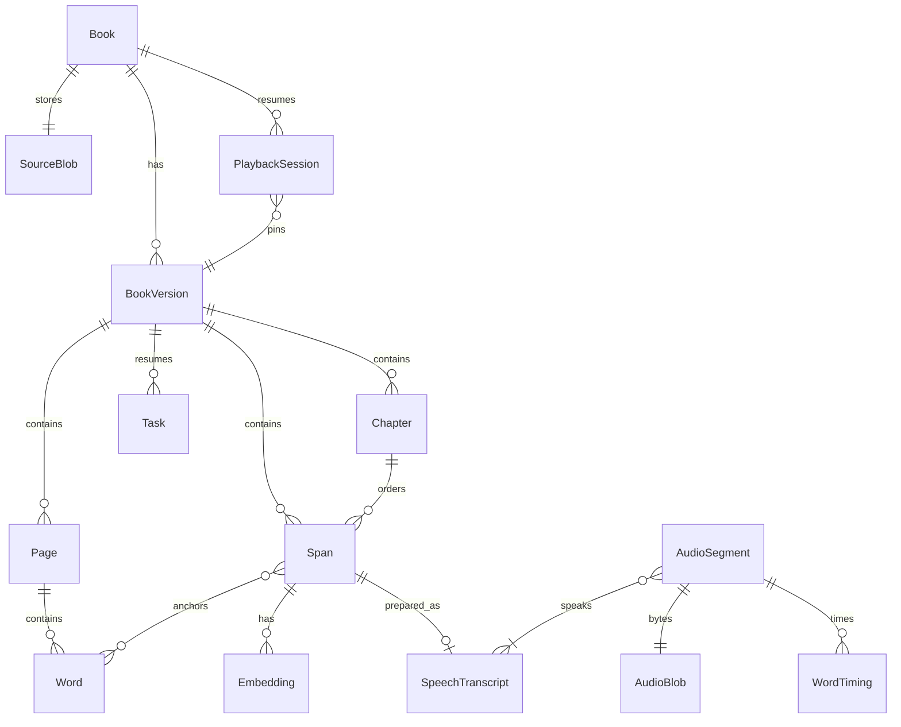

# Open Book Reader — design discussion

Status: discussion. This file records the product behavior, the processing and playback design, and a **suggested** stack. Library and model choices are a proposal. Two architecture rules are constraints:

- The browser is the system of record. Book bytes, page and word geometry, chapters, spans, metadata, embeddings, transcripts, audio, playback position, and task state live in IndexedDB. Blob values hold the file and audio bytes.
- The backend that runs transcription, analysis, and completion is stateless. A request carries everything that call needs. The response is the whole result. The server stores none of the book.

Discussion thread: https://github.com/manishsharma004/open-book-reader/issues/1

The original request, and where this document answers it:

| Request | Where it is specified |
| --- | --- |
| User uploads a book | [Upload](#61-upload) |
| Analyse the pages | [Page analysis](#62-page-analysis) |
| Separate the chapters | [Chapter separation](#63-chapter-separation) |
| Analyse the text and create full metadata | [Text analysis and metadata](#64-text-analysis-and-metadata) |
| Audio reading starts only after processing is done | [When play becomes available](#65-when-play-becomes-available) |
| A language model analyses the book in realtime | [Realtime preparation](#72-realtime-preparation) |
| Build transcription text for speech, with punctuation and emotion | [Speech transcript](#73-speech-transcript) |
| A speech model reads that transcription | [Speech synthesis](#74-speech-synthesis) |
| Page text highlights in sync with the audio clock | [Highlight sync](#75-highlight-sync) |
| Data, embeddings, and analysis stay in the browser | [Where work runs](#4-where-work-runs) and [IndexedDB](#5-indexeddb-storage-and-task-state) |
| Transcription, analysis, and completion run on a stateless backend | [Stateless model API](#43-stateless-model-api) |

## 1. Product

A reader uploads a book they already have. The browser studies the pages, finds the chapters, reads the text, embeds the speakable passages, and stores a structured description of the book on the device. When that work has finished, the reader may press play.

During playback the browser asks a stateless model API to prepare the upcoming passage for speech: the words to say, the punctuation that shapes pauses, and an emotion for delivery. A second stateless call turns that transcript into audio. The browser stores both results locally. The page highlights the words that are sounding at the audio element's current time.

The page the reader sees is the book page, not a reflowed article. Highlighting has to land on the printed text.

### In scope for this design

- One reader and the books they upload, stored in that browser.
- A batch processing pipeline that must finish before play, and that can resume after a reload.
- Embeddings computed and kept in the browser, used to retrieve context without uploading the book.
- A realtime path that prepares speech while a ready book is playing.
- A sync contract between audio time, spoken words, and page position.
- Enough metadata to describe the book, its chapters, and how names are pronounced.
- A stateless backend for model calls that the browser should not make with a vendor key.

### Out of scope for this design

- Choosing a final model vendor, hosting region, or price.
- Accounts, sharing, billing, and storefronts.
- A server-side library of the reader's books.
- Editing the book's prose.
- A mobile app. The reader is a web app in the suggestion below.
- Legal advice about the uploaded file. The product stores a file the reader supplies in their browser and treats it as private to them.

## 2. Reader journey

1. The reader picks a book file. The browser writes it into IndexedDB and shows **Uploaded**. The file is not uploaded to an application server as a stored object.
2. Progress moves through page analysis, embeddings, chapter separation, and text analysis. Play stays disabled. Progress is a count of IndexedDB task records.
3. Warnings are visible while the reader waits: low-confidence pages, missing title, uncertain chapter breaks. Processing can still finish with warnings.
4. Closing the tab pauses the pipeline. Opening the app again continues from the task records. The file is still in IndexedDB.
5. The book becomes **Ready**. The reader sees the chapter list, the metadata, and Play.
6. Play starts at the first speakable passage, or at the last position if they have listened before.
7. Audio starts from a blob stored locally, or from a blob just returned by the stateless speech call and then stored. The current word (or, if word times are missing, the current passage) is highlighted on the page. When the spoken word sits on the next page, the page turns and the highlight follows.
8. Pause, seek, speed changes, chapter jumps, and clicks on a word all move the same audio clock. The highlight reads that clock. It does not run on a second timer.
9. Leaving and coming back restores the position from IndexedDB.



The cycle through prepare, speech, local save, and highlight is the listening session. The path from storing the file to the gate is the batch pipeline. Play is not offered from a half-finished pipeline.

## 3. Two different uses of the language model

These are easy to collapse, and they should stay separate. Both are stateless calls. The browser stores the results.

**Batch, before play.** The model helps separate chapters when local signals are weak, fills metadata, writes summaries, lists people, and attaches pronunciation hints. The browser sends one chapter-sized payload, or the heading candidates, and writes the JSON onto the book version in IndexedDB. This work is part of "processing is done."

**Realtime, after play.** The model looks at the passage about to be spoken, plus a small amount of context the browser retrieved locally, and writes the speech transcript: punctuation, pauses, emotion, dialogue versus narration. The browser caches that transcript per passage and voice settings. This work is not part of the gate. A book can be Ready and still generate the next transcript a few seconds ahead of the voice.

Batch understanding makes the realtime call cheaper and more stable. The realtime call should not re-discover the chapter list or the cast on every sentence. The embedding index used to pick context stays in the browser and is not part of the request except for the few snippets the browser chooses to include.

## 4. Where work runs



The browser never sends the book as a stored object. Workers and the page write IndexedDB. The stateless API is a pure function from one request body to one response body.

### 4.1 In the browser

- The source file, page rasters, and audio segments, as blobs.
- Page text, word boxes, reading order, and word roles.
- OCR of scanned pages.
- Span building and hyphenation joining.
- Embeddings of spans and headings, and nearest-neighbor retrieval over those vectors.
- The task queue and the book-version state machine.
- Playback position, voice settings, and the highlight clock.
- Validation that a returned transcript still matches the printed words.
- Rendering the PDF and drawing highlight rectangles.

### 4.2 On the stateless backend

- Completion and analysis calls: chapter-boundary proposals, metadata, summaries, people, pronunciation, and the speech transcript.
- Speech synthesis from a transcript.
- Optional alignment, when the speech response has no word timings: audio bytes and the known transcript in, timings out.

Each of these is one request. The process may call a vendor. It writes no database row, no object, and no session. A second instance of the service can serve the next request. There is no affinity to a previous call.

### 4.3 Stateless model API

Suggested routes, so the constraint is concrete:

| Route | Request | Response |
| --- | --- | --- |
| `POST /v1/complete` | `kind` (`chapters`, `metadata`, or `transcript`), the text payload, and the response schema name | JSON matching that schema |
| `POST /v1/speak` | transcript, voice, style | audio bytes, media type, duration, optional word timings |
| `POST /v1/align` | audio bytes plus the transcript text | word timings |

Rules for every route:

- The server can handle the request without reading anything it saved earlier.
- A book id, if the client sends one, is ignored. It is not a key.
- Bodies are not written to application logs.
- Temporary files for a single request, if a vendor SDK needs them, are deleted before the response is finished.
- Repeating the same request is a new computation. The browser dedupes with its own cache key before calling.

Vendor API keys live only on this service. The browser receives results, not keys.

## 5. IndexedDB storage and task state

IndexedDB is both the store and the pipeline's state. A reload reads the same database and continues. There is one database for the origin.

Ask for persistent storage with `navigator.storage.persist()` after the reader adds a book, so the browser is less likely to evict the file under storage pressure. Quota is still finite. Audio blobs are the eviction candidates. Source files, pages, spans, embeddings, and metadata are the records a rebuild would be expensive to replace.

A Web Lock named for the book version keeps a single tab as the writer for that version. Other tabs can read.

### 5.1 Object stores

| Store | Key | Holds |
| --- | --- | --- |
| `books` | book id | filename title hint, current version id |
| `versions` | version id | state, warnings, book id |
| `pages` | page id | version id, page index, size in PDF points, confidence, extractor, and the page's words |
| `chapters` | chapter id | version id, title, start and end word ids, source, confidence |
| `spans` | span id | version id, chapter id, order, role, source word ids, source text |
| `embeddings` | embedding id | owner id, model id, dimensions, `Float32Array` vector |
| `metadata` | version id | the catalog in [Text analysis and metadata](#64-text-analysis-and-metadata) |
| `transcripts` | transcript id | span or utterance id, voice, style, clause JSON |
| `segments` | segment id | utterance span ids, duration, timing quality, blob id |
| `tasks` | task id | version id, kind, status, input ref, heartbeat, error |
| `sessions` | session id | version id, position, rate, voice, style |
| `blobs` | blob id | kind, media type, and a Blob |

Words live on the page record that produced them. A page is the unit of extraction and of drawing. Spans point at word ids on those pages. This keeps a 400-page book as hundreds of page records rather than one document.

Indexes the pipeline needs: pages by `(versionId, pageIndex)`, spans by `(versionId, order)`, tasks by `(versionId, status)`, embeddings by `(ownerId, modelId)`, blobs by kind.

### 5.2 Blobs

IndexedDB stores `Blob` and `File` values directly. Use that for:

- `source` — the original PDF
- `page-raster` — a rendered page, only when OCR needs pixels
- `audio` — one utterance

Structured records stay structured. A PDF is not base64 inside a JSON field. An audio segment record points at a blob id. Deleting the blob drops the cache and leaves the spans in place, so playback can call `/v1/speak` again.

### 5.3 Task state

Pipeline progress is a set of task records, not a server job id.

```json
{
  "id": "task_01",
  "versionId": "bv_01",
  "kind": "extract-page",
  "status": "queued",
  "inputRef": "3",
  "heartbeatAt": null,
  "error": null
}
```

Kinds follow the pipeline: `extract-page`, `ocr-page`, `build-spans`, `embed-spans`, `chapters`, `metadata`, `ready-check`. Page extraction tasks are one per page and may run with a small worker pool. Later kinds wait until the tasks they depend on are `done`.

The orchestrator, running in the page's worker support:

1. Takes the Web Lock for the version.
2. Selects a `queued` task whose dependencies are done.
3. Sets it to `running` and writes `heartbeatAt`.
4. Does the work. Model work is a stateless call. Everything else is local.
5. Writes the outputs and sets the task to `done` before releasing the claim.
6. On load, any `running` task whose heartbeat is older than about 30 seconds returns to `queued`.

Closing the tab stops the loop. It does not lose completed pages. The next open resumes at the first unfinished task.

### 5.4 Embeddings

Embeddings are computed in the browser and stored in the `embeddings` store. They are part of analysis, and they do not go to the backend as an index.

Suggested model class: a small sentence embedding running in a web worker (transformers.js, MiniLM-class). The model id is stored on every vector so a later model is a new set of rows, not an overwrite.

What they are for:

- Retrieve a handful of related spans as context for a realtime transcript call. The request contains those snippets. It does not contain the index.
- Compare a heading line with the lines around it when chapter signals disagree, before spending a completion call.
- Group repeated running headers locally so they can be marked `header` without a model call.
- In-book search later, against the same store.

A span's embedding is an input to Ready in the degraded sense below: the embed tasks should finish. If the embedding model cannot load, those tasks are marked skipped with a warning, retrieval context falls back to the previous and next spans, and Ready is still allowed. An embed task left `running` or `failed` without that explicit skip does block Ready.

Vectors are `Float32Array` values in IndexedDB, not strings of numbers inside the span record.

## 6. Batch processing

A **book version** is one complete analysis of one file, stored entirely in IndexedDB. Re-running analysis creates a new version. Playback binds to a version, so a reprocess does not move highlights under an active session. The new version becomes the one Play uses only after it is Ready.



A page that cannot be read is **terminal**. It is stored as unreadable, with no invented text. It does not by itself fail the book. A corrupt file, or a completion call that keeps failing until the reader stops retrying and leaves chapters or metadata unfinished, fails the version. The previous Ready version, if any, stays the one the reader can play. A failed stateless call is retried by re-queueing the task. The server remembers nothing that would make the retry different.

Page tasks may run in parallel in browser workers. Chapter separation starts after every page is terminal and embed tasks are done or explicitly skipped. Per-chapter metadata calls may run in parallel after the chapter list exists. The version becomes Ready only when the whole book has passed the gate in [When play becomes available](#65-when-play-becomes-available).

### 6.1 Upload

The reader picks a file. The browser writes the `File` blob into `blobs`, records the filename, size, and media type, and creates a book version in **Uploaded** plus the page tasks it can already count. Nothing in this step calls the backend.

Suggested first format: **PDF**, both text-layer PDFs and scanned PDFs. Page highlighting needs a stable page and a coordinate system. EPUB reflows with window width, so "the page" is not stable until we paginate for a specific layout. Photos of pages are a third extractor. Both can be added behind the same page extractor. They are not required to discuss the rest of this design.

The original blob stays stored so a later version can be built without asking for the file again.

### 6.2 Page analysis

This runs in the browser. PDF.js both draws the page and supplies the text extraction for a text-layer PDF, so the stored boxes and the rendered page come from one library. Highlighting uses the stored boxes. It does not string-match a second extraction at click time.

Each page produces:

- `page_index`, zero-based, in the file's order.
- `width` and `height` in PDF points.
- An ordered list of **words**. Each word has the printed text, a bounding box, a reading-order index, and a role.
- A page confidence and the extractor that produced it: `text_layer` or `ocr`.
- Warnings: low confidence, possible multi-column uncertainty, image-only page, encoding garbage.

Bounding boxes are in **PDF user space**: origin at the bottom-left of the page, units in points, unscaled. The client converts them with the same viewport it uses to draw the page. Pixel boxes from a thumbnail are not the stored geometry. Scanned pages still use this space: render at a known scale, OCR in that pixel space with tesseract.js inside a worker, and convert boxes back to PDF points.

Word roles:

| Role | Spoken by default |
| --- | --- |
| `prose` | yes |
| `heading` | yes |
| `footnote` | no, until the reader turns footnotes on |
| `caption` | no, until the reader turns captions on |
| `header` | no |
| `footer` | no |
| `page_number` | no |
| `table` | no; the words stay visible on the page |
| `unreadable` | no |

Dialogue is not a page-analysis role. It is a classification of prose spans, assigned later when the speech transcript is written.

Reading order is part of the page record. A two-column page stores column one top-to-bottom, then column two. Headers and footers are identified so they are not inserted into the column flow. Repeated headers can be confirmed with the local embedding of those lines. Line-end hyphenation is joined into one speakable word and keeps both boxes, so the highlight can cover the split glyph and the speech says the whole word once.

OCR text is accepted only with its confidence. Below a threshold (a number to pick during implementation, suggested starting point 60 on a 0–100 word confidence), the word is `unreadable` and is not spoken. A vision completion may retry that page once, as a stateless call that sends the page raster and returns words. The raster is not retained on the server. If the retry still fails, or the reader leaves it off, the page stays unreadable and the player shows a marker where that page would have been read. The vision retry is off unless the reader opts in, because it is the one path that sends a page image off the device.

The extractor does not paraphrase. It records glyphs it can defend.

### 6.3 Chapter separation

A chapter is a title plus a half-open range of speakable spans: start inclusive, end exclusive. Ranges do not overlap and, together with any explicitly skipped front matter, cover every speakable span.

Signals, used together, cheapest local signal first:

1. A table of contents, when the book has one. TOC entries carry a target page. They are the strongest signal.
2. Heading words from page analysis (`Chapter`, `Part`, numbered headings, a heading role plus a following prose block).
3. Local embedding similarity between a candidate heading and the surrounding body, to drop running headers that merely look like titles.
4. A stateless completion when the first three disagree or are missing. The request contains heading candidates and the TOC text, not the whole book, and not an instruction to invent chapters that have no anchor. Every proposed boundary must cite a page and a word id. A boundary with no anchor is discarded. The browser writes the kept boundaries into `chapters`.

Each chapter stores `title`, `start_word_id`, `end_word_id`, `confidence`, and `source` (`toc`, `heading`, `embedding`, or `model`). The reader can correct a boundary later. A correction writes a new book version in IndexedDB whose spans are retargeted. It does not require picking the file again. Correcting chapters is part of the design even if the first build only displays the suggestion.

Front matter (title page, copyright, dedication, contents) and back matter (index, bibliography) are chapters or non-chapters with a `matter` flag. The default listening path skips the contents pages and the index. The reader can open them.

### 6.4 Text analysis and metadata

"Full metadata" means the catalog below. A field that is not in the book is stored as unknown. The model must not fill a plausible author, year, or ISBN from outside knowledge. Inferred fields (a synopsis, a character description) are marked `inferred` and carry the span ids they are based on.

The browser builds the request from local chapter text. The stateless `/v1/complete` call with `kind: metadata` returns JSON. The browser validates it and writes `metadata`. The server does not keep the chapter text.

**Bibliographic**

- title, subtitle
- authors, in order
- language and script
- publisher, place, year
- ISBN
- edition

**Structure**

- page count
- chapter tree (a part contains chapters; a chapter contains sections when headings support that)
- word count, and speakable word count
- estimated listening time at the default words-per-minute, recomputed when the reader changes speed

**Understanding**

- short synopsis and a longer synopsis
- per-chapter summary
- people: display name, aliases, a one-sentence description, pronunciation
- places and other proper nouns that need a pronunciation
- optional content note, only when specific spans support it, stored with those span ids

**Quality**

- pages by extractor (`text_layer` vs `ocr`)
- unreadable pages
- low-confidence chapter boundaries
- embedding tasks skipped, if any
- fields left unknown

Every stored value has provenance: `found` (with word ids) or `inferred` (with word ids), plus a confidence from 0 to 1.

Pronunciation hints exist so the speech adapter can say a name the same way throughout the book. They are metadata, produced in batch, stored locally, and copied into the realtime request context by the browser.

### 6.5 When play becomes available

A version is **Ready** when all of the following are true:

1. Every page has a terminal analysis record, including pages marked unreadable.
2. Span records exist and each span points at one or more words.
3. Embed tasks are `done` or explicitly `skipped`.
4. The chapter list is stored, every boundary has a word anchor, and the ranges cover the speakable words without overlap.
5. The metadata record is stored in IndexedDB. Unknown fields are allowed. A crashed metadata task is not "unknown"; the version stays not Ready.
6. Bibliographic fields that were found in the text cite their anchors. The synopsis and per-chapter summaries are present or explicitly marked as skipped with a warning. A skipped summary does not block Ready. A missing metadata record does.

Realtime transcripts and audio blobs are not required for Ready. They are created when the reader plays, and then stored locally.

Until Ready, the client shows progress from the task store and does not start audio.

### 6.6 The speakable span

The span is the contract between metadata, embeddings, speech, and highlighting.

A span is a short run of words in reading order, usually a sentence, that will be prepared and spoken as a unit. It stores:

- stable id
- book version id
- chapter id
- order index
- role: `narration`, `dialogue`, or `heading` (finer roles can wait)
- source word ids, in order
- source text: the words joined with normalized whitespace, hyphenation already resolved, punctuation kept as printed

Spans do not contain headers, footers, or page numbers. Footnotes and captions are spans with `spoken: false` until a setting turns them on.

Spans are immutable inside a book version. A corrected chapter list or a new extraction is a new version. The embedding row for a span is keyed by span id and model id, and it is replaced only when that model id changes.

## 7. Listening session

### 7.1 Position

A playback position is `(book_version_id, audio_segment_id, offset_ms)` once audio exists. Before the first synthesis for a jump target, the position is `(book_version_id, span_id, word_id)`.

The session record in IndexedDB stores that position on pause and on a short interval while playing, so a closed tab can resume. The server has no session.

### 7.2 Realtime preparation

When play starts, or when the reader jumps, the browser prepares a **lookahead window**: the current audio segment and the next two. While segment N is playing, the window slides so N+1 and N+2 are ready before N ends.

Preparation for a span:

1. Load the span's source text and word ids from IndexedDB.
2. Load context locally: the previous span's transcript, the next span's source text, the chapter summary, the people and pronunciation sheet, the reader settings, and a few spans retrieved by embedding similarity. The retrieval result is a short list of texts. The vectors stay put.
3. Call `POST /v1/complete` with `kind: transcript` and that payload. The response is a speech transcript that must obey the schema in the next section.
4. Validate alignment in the browser. On failure, keep the source text as a single clause with emotion `neutral` and the original punctuation.
5. Call `POST /v1/speak` for a group of validated transcripts (an **utterance**). If timings are missing, call `POST /v1/align` with the audio bytes just received and the transcript text.
6. Store the transcript, the audio blob, and the word timings in IndexedDB. The cache key is `(book_version_id, utterance_span_ids, voice_id, style_id, transcript_hash)`.

A jump cancels lookahead fetches that are no longer near the new position. Cached audio for the destination is reused from IndexedDB. The server cannot cancel work it does not track; the browser simply ignores a response whose cache key is no longer in the window.

If the current utterance is not ready, the reader sees **Preparing** and hears nothing. The fallback transcript (original words, neutral emotion) is tried before surfacing a failure. The player does not skip ahead, because a skip would desynchronize the page from the story.



The realtime call sees a window the browser assembled, not the whole book. The batch pass already stored the book-level picture locally. Sending the entire book on every sentence is out of scope for this design.

### 7.3 Speech transcript

The transcript is what the speech call receives. It is not a retelling. The page highlights printed words, so the spoken words have to be those printed words. The browser stores this JSON. The server returns it and drops it.

Internal schema:

```json
{
  "span_id": "sp_0142",
  "book_version_id": "bv_01",
  "clauses": [
    {
      "text": "Stop,",
      "emotion": "tense",
      "role": "dialogue",
      "speaker": "Mara",
      "pause_after_ms": 180,
      "source_word_ids": ["w_12_088"]
    },
    {
      "text": "she said.",
      "emotion": "somber",
      "role": "narration",
      "speaker": null,
      "pause_after_ms": 280,
      "source_word_ids": ["w_12_089", "w_12_090"]
    }
  ]
}
```

Rules:

- `text` carries the words and the punctuation. Punctuation is how the voice phrases the line: commas, periods, question marks, ellipses, em dashes.
- The analyst may restore punctuation that extraction dropped. It may not replace, delete, or add content words. "Dr." stays "Dr." in the first version; a pronunciation override for a known abbreviation is a later, explicit field, not a silent rewrite.
- `emotion` is a closed set: `neutral`, `calm`, `warm`, `tense`, `somber`, `excited`, `whispered`, `angry`. Anything else is stored as `neutral`.
- `role` is `narration`, `dialogue`, or `heading`.
- `speaker` is an optional name that must already exist on the people list. The analyst does not invent a cast.
- `pause_after_ms` is a hint. The speech adapter may honor it as a break. Suggested cap: 800 ms, so a hint cannot insert a long silence.
- `source_word_ids` map the clause back to page words, in order.

Alignment check, in the browser, before the transcript is kept:

1. Compare clause text to the source words after case-folding and after treating punctuation as separate from words.
2. Accept when the content words are the same sequence. Punctuation may differ.
3. Reject otherwise, and use the fallback clause (source text, `neutral`).

Emotion is not drawn on the page. The page shows the book. Emotion affects the voice only.

The browser compiles clauses into whatever the current engine accepts before the speak call, or the speak call accepts the JSON and compiles it. For an engine that understands SSML, emotion and pauses become SSML. For an engine that accepts plain text, the adapter sends the punctuated text and drops emotion tags it cannot express. The stored transcript still has the emotion, so a later engine can use it without another analyst call.

Example of the same sentence as SSML, produced by the adapter, not stored as the source of truth:

```xml
<speak>
  <prosody emotion="tense">Stop,</prosody>
  <break time="180ms"/>
  <prosody emotion="somber">she said.</prosody>
</speak>
```

Engines name emotions differently. The adapter owns that translation. The rest of the system only sees the closed set above.

### 7.4 Speech synthesis

Consecutive ready transcripts are grouped into one **utterance** so the voice can phrase across sentence boundaries. Grouping happens in the browser. Grouping rules:

- Target about 8 to 25 seconds of speech. Short enough to seek and to retry, long enough for prosody.
- Do not cross a chapter boundary.
- May cross a page boundary. The page turns in the middle of the audio when the word's page changes.
- Do not include a span with `spoken: false`.

`POST /v1/speak` returns:

- audio bytes (suggested container: audio the browser can play in an `<audio>` element, such as AAC in M4A or Opus in audio/webm; pick one at implementation time and store the media type on the blob)
- duration
- word timings: `{source_word_id, start_ms, end_ms}` relative to the start of this audio segment

The browser writes the bytes into `blobs` and the timings onto the segment record, then plays the blob with an object URL or a `blob:` source. Timings come from the speak response when it provides them. When it does not, `/v1/align` runs on those same bytes and the known transcript, and the timings are mapped back through `source_word_ids`. The align request is also stateless. If alignment fails, the segment is stored with utterance-level timing only: the whole utterance's spans highlight for the duration, and the record is marked `coarse`. Coarse is a degraded mode, not the default.

### 7.5 Highlight sync

The audio element is the only clock. `currentTime` of the playing segment, interpreted with that segment's word timings, selects the word. Playback rate changes `currentTime` and the highlight together. Pause freezes both. A scrubber sets `currentTime`. There is no parallel animation timer estimated from word counts.



Client rules:

1. On each animation frame while playing, and on `seeked` and `ratechange`, read `currentTime`.
2. Find the timing with `start_ms <= currentTime < end_ms`. In a gap between words, keep the previous word highlighted.
3. Resolve source word ids to boxes stored on the page records.
4. If those words are on another page, change the page, then draw.
5. Convert PDF user-space boxes through the page viewport into overlay rectangles. The overlay sits on the rendered page.
6. A click or keyboard activation on a word seeks the audio to that word's `start_ms`, loading the segment blob first if needed. The highlight moves because the clock moved.

Chapter next and previous seek to the first spoken word of the target chapter. If that utterance blob is not in IndexedDB, the UI shows Preparing on that chapter, builds it through the stateless calls, stores it, then seeks.

Speed is a playback rate on the audio element (suggested range 0.8 to 1.6). It does not rewrite the transcript.

### 7.6 Worked example

Invented passage, as stored after page analysis. Page 3. Boxes are illustrative PDF points.

| Word id | Text | Box (x, y, w, h) |
| --- | --- | --- |
| w1 | Mara | 72, 640, 36, 12 |
| w2 | waited. | 112, 640, 52, 12 |
| w3 | The | 72, 622, 24, 12 |
| w4 | station | 100, 622, 48, 12 |
| w5 | clock | 152, 622, 36, 12 |
| w6 | had | 192, 622, 24, 12 |
| w7 | stopped | 72, 604, 52, 12 |
| w8 | at | 128, 604, 14, 12 |
| w9 | noon. | 146, 604, 36, 12 |

One span, `sp_3_1`, words w1–w9, role `narration`, chapter "Chapter 1". Its embedding is a local vector. The realtime request includes this span's text and, if retrieval finds them, a few short neighbor snippets. It does not include the vector.

Realtime transcript, stored after `/v1/complete` returns and the browser accepts the alignment:

| Clause text | Emotion | Source words |
| --- | --- | --- |
| Mara waited. | calm | w1, w2 |
| The station clock had stopped at noon. | somber | w3–w9 |

The content words match, so the transcript is kept. "waited." and "noon." keep their periods.

`/v1/speak` returns a 4.2 s segment. The browser stores the blob and these timings:

| Start | End | Word |
| --- | --- | --- |
| 0.00 | 0.48 | w1 Mara |
| 0.48 | 1.05 | w2 waited. |
| 1.40 | 1.62 | w3 The |
| 1.62 | 2.10 | w4 station |
| 2.10 | 2.48 | w5 clock |
| 2.48 | 2.70 | w6 had |
| 2.90 | 3.40 | w7 stopped |
| 3.40 | 3.58 | w8 at |
| 3.58 | 4.20 | w9 noon. |

At `currentTime = 1.80` the highlighted word is **station**, box `(100, 622, 48, 12)` on page 3, converted by the current viewport. The gap from 1.05 to 1.40 keeps **waited.** highlighted. A click on **noon.** seeks to 3.58. At rate 1.5 those same millisecond boundaries still apply, because they are inside the audio's own timeline.

If this segment had only coarse timing, the highlight would cover w1–w9 for the whole 4.2 s and the record would say `coarse`.

## 8. Records

The records in [IndexedDB storage and task state](#5-indexeddb-storage-and-task-state) are the physical store. The names below are the design objects. All of them are local.



- **Book.** Title hint from the filename until metadata replaces it, current Ready version id. No server owner record. The owner is whoever can open this browser profile.
- **SourceBlob.** Blob id, media type, byte size, hash.
- **BookVersion.** State, warnings, created time. Immutable once Ready except for cached transcripts and audio, which attach to it without changing spans.
- **Page, Word.** As in page analysis.
- **Chapter, Span, Embedding.** As above.
- **Metadata.** The catalog in [Text analysis and metadata](#64-text-analysis-and-metadata), one record per version, fields individually provenanced.
- **SpeechTranscript, AudioSegment, AudioBlob, WordTiming.** Cache. Safe to delete; playback can rebuild them with stateless calls.
- **Task.** The resume record for processing.
- **PlaybackSession.** Version id, segment id, offset, rate, voice, style.

Ids are opaque strings minted in the browser. Page numbers are attributes, not identities, because a reprocess can change them. Sessions point at a version so identities stay stable for the life of that version.

## 9. Failure behavior

| Situation | Behavior |
| --- | --- |
| Corrupt file, no pages | Version **Failed**. Message explains that the file could not be opened. The blob remains so the reader can remove it. |
| Tab closed mid-pipeline | Tasks already `done` stay done. Stale `running` tasks return to `queued` on the next open. |
| One OCR page fails | That page is unreadable. Other pages continue. The listening path shows a short marker and moves to the next spoken span. |
| Chapter model returns a boundary with no word id | Boundary is dropped. If nothing remains, the book is one chapter titled with the book title, and a warning is stored. |
| Completion call fails | The task returns to `queued` with the error. The version is not Ready. Spans already built stay in IndexedDB. The retry sends the payload again. |
| Embedding model cannot load | Embed tasks are marked skipped with a warning. Retrieval uses neighbor spans only. Ready is still allowed. |
| Transcript fails alignment | Fallback clause: original span text, neutral emotion. Highlight still has word ids. |
| Speech or align call errors | Preparing state, then a retry. The player does not skip the span. |
| Alignment cannot produce word times | Segment marked `coarse`. Highlight the utterance's spans for its duration. |
| Reader seeks into an uncached chapter | Preparing on that chapter, then play from its first spoken word. |
| Storage quota exceeded | Stop creating new audio blobs, keep analysis records, and evict the oldest audio blobs that are outside the current lookahead. Show that listening may need to synthesize again. |
| Reprocess while a session is open | The open session keeps its version. The next new session uses the new Ready version. |
| Two tabs open the same version | The Web Lock makes one tab the writer. The other shows progress from IndexedDB. |

Progress for the waiting screen is countable: tasks done / tasks in the current stage, reported as pages, then embeddings, then chapters, then metadata. Percentages that jump backward are worse than stage counts.

## 10. Privacy

The book at rest stays in the browser. IndexedDB is the copy that exists.

A stateless call still sends some text off the device, and only that:

- Chapter proposals send heading candidates and TOC text.
- Metadata completion sends the chapter text the browser put in that request.
- Realtime preparation sends the upcoming spans and a small retrieved context.
- Speech synthesis sends the transcript, which is the printed words plus emotion.
- An opted-in vision retry sends one page image.
- Align sends one utterance's audio and its transcript.

The embedding index, the source PDF, the page word store, playback position, and cached audio are not uploaded as data to keep. The speak and align calls contain audio only for the duration of that request.

The browser does not receive vendor API keys. Server logs omit request and response bodies.

Caches (transcripts, audio blobs) are derived data in IndexedDB and can be deleted without deleting the book version. The server has nothing corresponding to delete.

If even those request bodies are unacceptable, the same browser interfaces can call a local model instead of `/v1/complete` and `/v1/speak`. Emotion quality has to be judged again on that path. The storage design does not change.

## 11. Settings that change output

Stored on the playback session in IndexedDB, and part of the audio cache key when they change the sound:

- voice
- emotional intensity: `subtle` (bias emotions toward `calm` / `neutral` unless the transcript says `whispered` or `angry`) or `full` (use the transcript emotion as returned)
- speaking rate, applied at playback, not by regenerating audio
- footnotes on or off
- captions on or off

Changing voice or intensity prepares a new window. Changing rate does not.

## 12. Suggested stack

Proposal for the libraries. It is specific so the constraints have somewhere to land. It is not a lock. The constraints in the status section are not optional parts of this proposal.

### 12.1 Shape

A static web app and a stateless model service.

```text
apps/web          Vite, React, TypeScript
apps/model-api    FastAPI, no database
specs/discussion  this document
```

The web app has no server session and no application database. Vite is the suggestion because the app's storage is IndexedDB, not a server render. The model API can be scaled as identical stateless replicas.

Local development runs the web app and the model API. It does not run PostgreSQL, Redis, or object storage.

### 12.2 Components

| Concern | Suggestion | Why this one |
| --- | --- | --- |
| Reader UI | Vite, React, TypeScript | Upload, progress, chapter list, and the player, with storage in the page |
| Draw and extract the PDF | PDF.js | One library renders the page and produces the text items whose boxes we store |
| Highlight | Rectangles on an overlay, converted with the PDF.js viewport | Geometry comes from the boxes stored at extraction |
| Local workers | Web Workers | Page extraction, OCR, and embeddings stay off the UI thread |
| Records and blobs | IndexedDB, via the `idb` helper | Transactions, indexes, and `Blob` values. This is the state manager for tasks |
| Cross-tab writer | Web Locks | One orchestrator per book version |
| Quota | `navigator.storage.persist()`, evict audio blobs first | Analysis records outlive the speech cache |
| Scanned PDF | PDF.js render to a bitmap, then tesseract.js | OCR stays in the browser |
| Embeddings | transformers.js, MiniLM-class, in a worker | Vectors are computed and stored locally |
| EPUB, camera images | Later, same in-browser extractor interface | Stable pages are the highlighting problem we are solving first |
| Completion | `POST /v1/complete` on the stateless API | Chapters, metadata, and transcripts are structured output. Starter to discuss: OpenAI structured outputs, called only from the API process |
| Speech | `POST /v1/speak`. Starter to discuss: an ElevenLabs-class API behind that route | The product asks for emotion, punctuation, and a voice |
| Word times | Timings on the speak response; otherwise `POST /v1/align` | The align call sees the bytes once and returns timings |
| Clock | HTML `<audio>` `currentTime` on a local blob | One clock for play, pause, seek, and rate |
| Model API | Python 3.12, FastAPI | A thin proxy with a schema check, no store |

### 12.3 What the model API must not grow

- A book table, a user table, or a job table.
- Object storage for PDFs or audio.
- A queue of the reader's pipeline. The task queue is IndexedDB.
- Sticky sessions.

If a feature needs those, it belongs in the browser, or the design needs a new discussion.

### 12.4 Interfaces

These seams keep the library choices replaceable. The first three run in the browser. The last three are the stateless calls, or an in-browser implementation of the same function signatures.

```text
PageExtractor.extract(blob) -> pages and words          // browser
Embedder.embed(spans) -> vectors                        // browser
Retriever.nearest(vector, k) -> span snippets           // browser, over IndexedDB

complete(kind, payload) -> JSON                         // POST /v1/complete
speak(transcript, voice) -> audio and optional timings  // POST /v1/speak
align(audio, transcript) -> word timings                // POST /v1/align
```

The browser validates every completion against the transcript and metadata schemas before writing IndexedDB.

### 12.5 In-browser models and the stateless calls

Page extraction, OCR, and embeddings are in-browser in this suggestion, not as an alternate path.

Completion and speech stay on the stateless API so vendor keys stay off the page. The same function signatures can later call an in-browser model when one is good enough. Storage does not move when that happens.

### 12.6 What this suggestion intentionally leaves open

- The exact model version and the account that bills the stateless calls.
- Audio codec, as long as the browser can play it and the blob stores the media type.
- The numeric OCR confidence cutoff.
- Whether the first build includes a chapter-correction UI or only displays suggested chapters.
- How large a PDF the first version is expected to finish on a typical laptop. The pipeline is per page and per task. A suggested discussion target is a 400-page novel, with audio cached only around the playhead plus a bounded history.
- Whether `/v1/align` is a separate route or a mode of `/v1/speak`. The behavior is the same: bytes in, timings out, nothing kept.

## 13. Open questions

1. Is PDF-only the right first upload, with EPUB explicitly later?
2. Is the Ready gate correct to wait for the whole book, rather than allowing play from chapter 1 while later chapters are still processing? This document follows the request: processing finishes, then audio starts.
3. Should headings be spoken, and should "Chapter 3" be spoken as well as shown?
4. May the transcript restore punctuation the extractor dropped, given that content words must stay identical?
5. Is word-level highlight the acceptance bar, with coarse utterance highlight only as a failure mode?
6. One voice for narration and dialogue in the first version, or a second voice when `speaker` is set?
7. Should metadata completion and the speech transcript stay on the stateless API, or move in-browser under the same function signatures once a local model is good enough? Embeddings and page data stay in the browser either way.
8. How much audio history should IndexedDB keep before evicting blobs?
9. Should the reader confirm uncertain chapter boundaries before Ready, or fix them after listening is already possible?
10. Are tables ever spoken, or always left as on-page content?
11. Is an opted-in vision retry for failed OCR pages acceptable, given it sends a page image to the stateless API?

## 14. Follow-up discussions

These are slices of this document, not extra product. Open them when implementation is actually being planned.

- IndexedDB object stores, blob kinds, task resume, and the Web Lock.
- In-browser page extractor contract, including OCR confidence and PDF user-space boxes.
- Embedding model, what it indexes, and what a transcript request is allowed to include.
- Stateless `/v1/complete`, `/v1/speak`, and `/v1/align` contracts, including the rule that bodies are not logged.
- Chapter boundary records and later correction.
- Speech transcript schema, alignment rejection, and the emotion set.
- Audio segment grouping, timing, and the highlight overlay.
- Book version state machine and the Ready gate.

## 15. Acceptance for a later implementation

When this design is built, a test book (a short PDF we have rights to use) should demonstrate all of the following:

1. The file, pages, spans, embeddings, and metadata are readable from IndexedDB after processing. The model API has no book record.
2. Upload moves to Ready only after pages, embeddings or an explicit skip, chapters, spans, and the metadata record exist.
3. Play is unavailable before Ready.
4. Reloading in the middle of processing continues from task records and does not ask for the file again.
5. At a paused `currentTime`, the highlighted boxes are exactly the words whose timings contain that time.
6. Seeking the audio moves the highlight. Clicking a word seeks the audio.
7. A page turn happens because the next word's page index changed, during continuous audio.
8. A transcript whose words differ from the page is rejected in the browser, and the spoken fallback is the printed sentence.
9. Emotion is present on the transcript stored in IndexedDB and is not painted onto the page.
10. Deleting the audio blob and playing again rebuilds it with a new stateless speak call. The source spans never left IndexedDB.
11. Two identical complete calls succeed with no server session between them.
