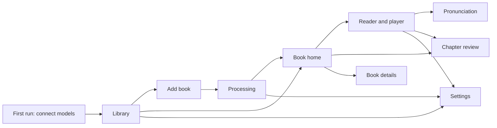

# Open Book Reader — screens and interaction

Status: discussion. Part of the design in [`DESIGN.md`](https://github.com/manishsharma004/open-book-reader/blob/main/specs/discussion/DESIGN.md). Connection details are in [`PROVIDERS.md`](https://github.com/manishsharma004/open-book-reader/blob/main/specs/discussion/PROVIDERS.md).

## 1. Principles

- **The page is the interface.** The reader looks at the book page they know, with the spoken word marked on it. Controls stay out of the page area.
- **Never wait silently.** Every wait shows what is happening, why, and what the reader can do: connect a model, skip a step, lower the speed, or prepare ahead.
- **Degrade, don't stop.** Missing a text model, a speech model, word timings, or the network changes what the reader gets, and the UI says what changed. It does not block listening when listening is possible.
- **The device holds the only copy.** The UI makes storage, persistence, and export visible, because losing browser data loses the library.
- **Costs are visible before they are spent.** Before large model work, the UI shows character and token counts for the reader's vendor.
- **The chrome looks like a book, not a dashboard.** The default palette is Ink: cool paper and ink blue by day, blue-black at night. Lamp, the warm paper palette, stays available. Type and the highlight treatment are in `DESIGN.md`.

## 2. Screen map



## 3. Screens

### 3.1 First run

Three choices, one screen:

1. **This computer runs the models.** Kokoro is the recommended voice and ships beside the app server, so its fields are prefilled and tested first. Ollama at `http://127.0.0.1:11434` is prefilled for text. Each has **Test**.
2. **Use a hosted vendor.** Vendor picker, API key field, **Test**.
3. **Skip for now.** Explains level 0: local analysis and the browser's built-in voice, no stored audio.

A **Try with a sample book** link adds a short bundled public-domain book so the reader can check the whole setup before using their own file. Successful tests show the model list and play a voice sample.

### 3.2 Library

- Grid of books: cover (first page render), title, author when known, state badge (**Processing 64%**, **Needs you**, **Ready**, **Failed**), listening progress bar, and prepared-audio size.
- Drop zone and **Add book** button. Dropping a file that is already in the library opens that book.
- Storage bar at the bottom: used and available bytes from `navigator.storage.estimate()`, persistence status, and **Manage storage**.
- Menu per book: Export, Remove prepared audio, Reprocess, Delete.
- Empty state: "Add a PDF you own. It stays in this browser." and the sample book link.
- Banner on Safari when not installed to the Home Screen: "Safari may delete this library after 7 days without a visit. Add to Home Screen to keep it." With **How** and **Dismiss**.

### 3.3 Add book

- File picker accepts PDF. Size and page count shown after the browser opens the file.
- Language of the book (defaults to the browser language), used for OCR and for the voice. Changeable later.
- Optional: **Speak footnotes**, **Speak captions**. Defaults off.
- If the PDF needs a password, a password field appears with **Remember on this device**.

### 3.4 Processing

```text
Processing "The Long Station"                                   about 6 min left
  Reading pages        ███████████████████░░░░  312 / 400   (scanned pages: 41)
  Building passages    waiting
  Embedding            waiting
  Finding chapters     waiting
  Book details         waiting
[ Keep screen awake ]                                     [ Pause ]  [ Cancel ]
```

- Stages are task counts from IndexedDB, with time left from the measured rate.
- The reader can open the PDF and page through it while processing runs.
- **Needs you** cards appear inline when a task is blocked:
  - "This PDF is password protected." → password field.
  - "Book details need a text model." → **Connect a model** or **Continue without one** (explains what will be missing: summaries, people, pronunciation hints, emotion).
  - "Storage is full." → **Manage storage**.
- On mobile: "Keep this screen open. Phones pause work in background tabs." with the wake lock toggle on.
- Warnings collect in a collapsible list: pages read by OCR with low confidence, uncertain reading order, chapter breaks with low confidence. Each links to the page.

### 3.5 Book home

Shown when the book is Ready.

- Title, author, cover, listening time at the reader's speed, chapter list with durations and **prepared** markers.
- **Play** (or **Resume, chapter 7, 12 min in**). If the reader has been away for more than a few days and a chapter summary exists, the resume button offers **Recap** first: a short spoken summary of the story so far up to the resume position.
- **Prepare** menu: next 30 minutes, this chapter, whole book. Shows the estimated characters and tokens, and the estimated time from measured throughput, before starting.
- Flags: "3 chapter breaks look uncertain. Review." links to chapter review.
- **Book details**: metadata with **Found in the book** or **Inferred** badges and an edit pencil per field.

### 3.6 Reader and player

```text
┌─────────────────────────────────────────────────────────────────────┐
│ ‹ Library   The Long Station · Ch. 7 "Noon"          Aa  ⚙  ☰       │
├─────────────────────────────────────────────────────────────────────┤
│                                                                     │
│     ...Mara waited. The [station] clock had stopped at noon.        │
│                 ‾‾‾‾‾‾‾‾‾‾‾‾‾‾‾‾‾‾‾‾‾‾‾‾‾‾‾‾‾‾‾‾‾‾‾‾‾‾‾‾‾              │
│                                                  page 112 / 400     │
├─────────────────────────────────────────────────────────────────────┤
│ ⏮  ⟲15  ▶  15⟳  ⏭    ──●──────────── 12:04 / 38:10    1.25×   ☾  🔖 │
│ Prepared ahead: 2 min · Word highlight                              │
└─────────────────────────────────────────────────────────────────────┘
```

- Current word filled, current sentence underlined. The underline is a non-color cue.
- **Play** and **Pause** share one position on the page. Pause leaves the current word marked. Play continues from that word. With the browser voice the word is spoken again from its start. With stored audio, Play continues at the same sample. Clicking a word moves the position there. On a page with no browser voice, the page stays on screen and Play says the voice is unavailable.
- The scrubber covers the current chapter. Prepared ranges are shaded on it; scrubbing into an unprepared range shows **Preparing** at that point.
- Status line: seconds prepared ahead and the highlight quality (**Word highlight**, **Sentence highlight**, **Preview voice**). Word highlight is the normal case. Sentence highlight is labeled as reduced.
- Crossing a table shows **Table, not read** on that region and the audio continues at the next spoken span.
- **View**: Page (default), Text (reflowed spans in Literata, adjustable size, line height, and spacing), Side by side on wide screens.
- The **Aa** menu sets size and Day, Night, or System. The first visit follows the system until the reader chooses.
- **Follow along** is on by default. Manual page turns or scrolling switch it off and show **Back to reading position**.
- Tap or click a word: seek there. Long-press or right-click a word: **Play from here**, **Fix pronunciation**, **Bookmark**, **Copy sentence**.
- **Go to page** sits with Previous and Next. The reader types a page number and presses Enter, **Go**, or leaves the field. The number is clamped to the book. `G` focuses the field unless another field already has focus. Previous, Next, and the page slider stay.
- The page slider shows the current page on its left and the total on its right. Dragging the slider updates the current page before the book opens that page.
- A horizontal swipe on the page turns it. The page follows the finger, slides off, and the next page comes in from the other side. A short swipe snaps back. The first page does not move on to a previous page, and the last page does not move on to a next page. With reduced motion, the swipe changes the page without the slide.
- Table of contents drawer (☰): chapters, bookmarks, search.
- Search: text search across spans, with an option for **Similar passages** that uses the local embeddings.
- Sleep timer (☾): 15, 30, 45, 60 minutes, end of chapter. Fades out over the last 10 seconds.
- Bookmarks (🔖): saved at the current word, with an optional note.

### 3.7 Chapter review

- Chapter list on the left, page view on the right with boundaries drawn as a marker before the first word.
- Each chapter shows source (**Bookmarks**, **Contents page**, **Heading**, **Model**) and confidence.
- Actions: rename, merge with next, split here (at a selected word), move boundary (drag the marker to another word), mark as front or back matter (not spoken by default).
- Edits save immediately. A toast says how many prepared minutes were dropped because they touched a changed boundary, with **Undo**.

### 3.8 Pronunciation

- List of terms with **Say as** text and a play button that synthesizes the term with the current voice.
- Model suggestions from metadata appear as **Suggested** with Accept and Dismiss.
- Saving a fix shows how many prepared utterances will be rebuilt.

### 3.9 Settings

| Section | Contents |
| --- | --- |
| Connections | Separate forms for VLLM, emotion analysis, and TTS. Each has a base URL, model, and API key. VLLM and emotion analysis tell the reader that completion is forwarded only to local Ollama on port 11434, an LLM on port 5173 at 127.0.0.1, localhost, or 127.0.0.1, or `OLLAMA_ALLOW`. TTS tells the reader that speech is forwarded only to Kokoro on port 8880 at 127.0.0.1, localhost, or 127.0.0.1, OpenAI, ElevenLabs, or `SPEECH_ALLOW`. TTS also has vendor, voice id, a voice sample, and **Create ElevenLabs voice**. **Test** calls the proxy |
| Reading | Palette (Ink or Lamp), pages prepared ahead (2 or 3), OCR language, browser voice or vendor voice, emotion (auto or a named emotion), Day / Night / System |
| Storage | Per-book usage (source, pages, embeddings, audio), persistence status with **Request persistence**, prepared-audio cap (default 200 MB per book), **Export library**, **Remove all prepared audio** |
| Privacy | What each model call sends (table from `DESIGN.md`). **Send unreadable pages to the text model** is off and is enabled per book; the control says the page image is sent |
| About | App version, server version and audio conversion status from `/v1/health` |

**Emotional intensity Off** sends no emotion directions; the transcript still adds punctuation and pauses.

## 4. Player controls and shortcuts

| Action | Control | Key |
| --- | --- | --- |
| Play or pause. Pause keeps the position. Play continues from it | ▶ | `Space` or `K` |
| Back or forward 15 s | ⟲15 / 15⟳ | `J` / `L` |
| Previous or next page | Previous / Next, page slider (current page and total), swipe left or right | |
| Go to a page number | Go to page | `G`, then the number and Enter |
| Previous or next sentence | | `←` / `→` |
| Previous or next chapter | ⏮ / ⏭ | `Shift+←` / `Shift+→` |
| Slower or faster (0.1 steps, 0.5–3.0) | 1.25× | `[` / `]` |
| Back to reading position | button | `F` |
| Bookmark | 🔖 | `B` |
| Toggle page or text view | Aa | `T` |
| Search | ☰ | `/` |
| Show shortcuts | | `?` |

Headphone and lock-screen buttons use the Media Session API: play, pause, seek back, seek forward, previous chapter, next chapter. Lock-screen artwork is the cover.

## 5. States and microcopy

| State | Where | Message | Actions |
| --- | --- | --- | --- |
| Preparing current audio | Player | "Preparing the next part…" with a spinner after 300 ms | Cancel goes back to pause |
| Preparing is slow | Player, after 8 s | "The voice is taking longer than usual ({host})." | Use preview voice for now, Keep waiting |
| Voice slower than playback | Player status | "Your voice model makes audio slower than you're listening. Playback may pause." | Lower speed, Prepare this chapter |
| Speech failing | Player | "Can't get audio from {profile}: {vendor message}" | Retry, Open settings, Use preview voice |
| Key rejected | Settings and toast | "{vendor} rejected the API key." | Edit key |
| Model not found | Settings | "{host} has no model named {model}." | Pick from list |
| Can't reach host | Toast | "The app server can't reach {host}. Is it running?" | Retry, Open settings |
| App server offline | Banner | "Offline. Prepared chapters still play." | none |
| Sentence highlight only | Status line | "Sentence highlight: this voice doesn't report word timing." | Add timing model |
| Table skipped | Player, over the table | "Table, not read" | none |
| Preview voice | Status line | "Preview voice: built into your browser. Connect a voice model for stored audio." | Connect |
| Storage nearly full | Library banner | "Storage is 90% full. Old prepared audio will be removed first." | Manage storage |
| Persistence denied | Settings → Storage | "The browser may clear this library when space is low. Export books you care about." | Export library |
| Export reminder | Library, monthly or after a new book | "Your books exist only in this browser." | Export library, Later |

## 6. Accessibility

- All controls reachable by keyboard with visible focus. Shortcuts do not fire while a text field has focus.
- The page canvas is a picture to assistive technology. The **Text** view is the accessible reading surface: real text, headings per chapter, adjustable size, line height, and spacing.
- The highlight overlay is `aria-hidden`. The current sentence is not announced during playback, because a screen reader and the audiobook would talk over each other. When paused, the text view's focus moves to the current sentence.
- Player state changes (Playing, Paused, Preparing, chapter changes) go to a polite live region.
- Highlight colors meet 3:1 contrast against the page background, with the sentence underline as a second cue. A high-contrast highlight preset is available.
- `prefers-reduced-motion`: page turns and scrolling jump instead of animating. A swipe still changes the page, without the slide.
- Captions-like mode for listeners who are hard of hearing is the text view with follow along, which shows the spoken sentence in large type.
- Book language sets the `lang` attribute on the text view, so assistive technology uses the right pronunciation rules.

## 7. Mobile

- Player controls in a bottom bar, chapter drawer and settings as bottom sheets. The page fits width; pinch to zoom; double-tap toggles Text view.
- Listening continues with the screen locked while the audio element plays. Starting the next segment while locked can fail on some mobile browsers when switching elements; the design's fallback is a single media element fed by Media Source Extensions (ManagedMediaSource on iOS). This is a prototype test item.
- Processing a large scanned book on a phone is slow and pauses in the background. The add-book screen says so for scanned PDFs over 100 pages and suggests processing on a computer, then exporting and importing the book.
- The install prompt (Add to Home Screen) is shown after the first book is Ready, and earlier on Safari because of storage eviction.
- Touch targets at least 44 by 44 CSS pixels.

## 8. Things deliberately left out of the first version

- Multiple voices per book (narrator plus characters). The transcript carries `speaker`, so this can be added without a new schema.
- Notes and highlights beyond bookmarks.
- Sync between devices. Export and import cover moving a book.
- Reading statistics.
